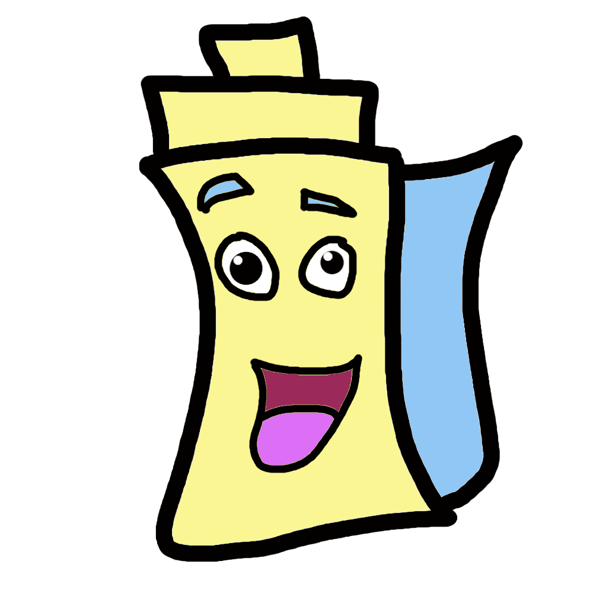

# lacarta

<p align="center">
  
</p>

One program per machine that gives Claude Code sessions a shared, gated process and a web console to follow and steer them. It comes with the agent skill that tells agents how to use it.

Kinds of project:

- **Software development**: the main framework.
  1. **Specification**: functional, architecture, tech stack, and security / threat model specs, plus a phase plan, each approved by you.
  2. **Implementation**: one phase at a time, each closed by a functional review, a security review and your approval. A high or critical finding stops development until you decide.
  3. **Final review**: two fresh agents (functional, security) with no memory of the build, judging only the repository.
- **Security audit** of a codebase, on [Cloudflare's security-audit skill](https://github.com/cloudflare/security-audit-skill): you approve the scope and the coverage plan, review every finding, and sign the report.
- **Review desk**: reviews merge requests on a GitLab instance in a loop, posting only what its mode and policy allow.
- **Incident response**: one case per incident or vulnerability, with a timeline, investigations, evidence, response actions you approve, and situation and final reports.
- **Single-agent task**: any other session you add to the console.

One web console per machine shows your projects and the agent sessions you add to it:
- the questions waiting for you and notifications;
- each session's chat (with remote control, you can write to an agent from the browser);
- each kind's own views: specs, decisions, phases, reviews and findings for software; findings and the report for audits; the queue for desks; the timeline, actions and reports for incidents.

Reports and findings can be copied as Markdown, downloaded or printed to PDF.

Claude Code sessions join the console through hooks, but only when asked. A session in a lacarta project's folder (software project, review desk, incident case, or an audit's target) joins it on its own. Any other session stays out until you, or the agent at your request, run `lacarta track`. It then appears as a single-agent task, and later sessions in that folder join it on their own. With `"auto_track": true` in `~/.lacarta/config.json`, every session joins. Models and skills per kind of project and role are set in the config files; `lacarta config` shows where.

## Install

Build the binary (Go 1.26), then install the hooks and the skill:

```bash
cd lacarta-go
go build -o ~/.local/bin/lacarta ./cmd/lacarta
lacarta install     # hooks in ~/.claude/settings.json (backup kept), the skill in ~/.claude/skills/lacarta; --uninstall removes both
```

Restart running sessions. In any project: "let's build an invoice tracker", "audit this repository", or "use lacarta for this". After rebuilding the binary, sessions refresh the installed skill on their own.

## Console

One daemon serves every project at `http://127.0.0.1:4747/`. Sessions start it when they register; `lacarta serve` prints its URL, or starts it. Agents never start it themselves: if it isn't running, they ask you to.

Where things are kept:
- **Machine-wide state:** `~/.lacarta/` (`$LACARTA_HOME`) holds the project registry, the config file, single-agent tasks, and `hooks.log` if a hook fails.
- **A project's state:** its own `.lacarta/` folder.

By default the console binds to loopback, rejects foreign `Host` and `Origin` headers, and requires a per-run token for every change. It only serves session transcripts from inside `~/.claude/`.

**Remote control.** Each session keeps `lacarta listen` running as a background command. When you write from the console, answer a question or ask about one, the listener returns and Claude Code wakes the agent, even when its turn had ended. The terminal stays usable the whole time. Turn it off machine-wide in the console's Settings, or per project in its Chat.

To reach the console from another machine, start it on another address: `lacarta serve --host 10.0.0.5` (or `--host 0.0.0.0 --allow-host my-box.lan`). The page and API then require the key printed in the URL (`?key=…`). Traffic is plain HTTP, so use a trusted network, or keep the default and tunnel with `ssh -L 4747:127.0.0.1:4747 host`.

## Layout

```
lacarta-go/           the program: CLI, hooks, daemon, console (see its README)
lacarta-go/skill/     what agents read: SKILL.md and references/ (installed by `lacarta install`), spec templates, desk and incident guides
lacarta-go/docs/      specification (docs/specs/) and design notes per kind (docs/design/)
docs/next-steps.md    where development stands and what comes next
assets/logo.png
```
