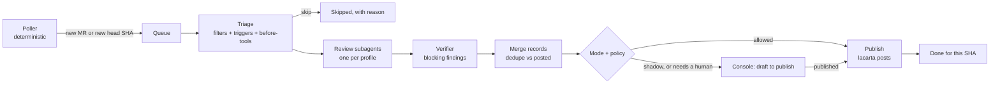

# Design: the review kind (MR / PR review desk)

Status: **first version implemented** (2026-11-17). See "Implementation status" below for what was built, how it
differs from this design, and what is left. Third project kind after `software` and `audit`; the one that makes the
`Kind` interface worth extracting (see [go-port-plan.md](../../../docs/go-port-plan.md#kinds) and
[security-audit.md §7](security-audit.md#7-using-the-kind-interface)). Decisions taken are in §12, open items in §13.

The audit design's principles carry over unchanged: lacarta orchestrates and records, skills and instructions hold the
method, deterministic code wraps every agent, and nothing reaches the outside world unless a human allowed it.

## Implementation status

Built and tested (`go test ./...`: `internal/core/desk_test.go` table-tests every hard rule of the policy, record
validation and config parsing; `internal/desk/guard_test.go` the command guard; `internal/cli/desk_test.go` drives two
whole desks against a fake GitLab, the real `glab` adapter included; Playwright `web/app/tests/desk.spec.js` edits and
publishes a draft from the console):

| Part | Where |
| --- | --- |
| Kind `desk` ("Review desk"): roles orchestrator, reviewer, verifier; a desk is a folder with `.lacarta/state.json`, registered in the hub as `desk` | `internal/core/desk.go`, `core.RegisterFolder` |
| `desk` settings in the desk's `config.json`, validated key by key (`config check` and the console show warnings); identity folders checked inside this environment's config home, never on a host mount, symlinks resolved | `internal/core/deskconfig.go` |
| Forge: GitLab over `glab api`, explicit `GLAB_CONFIG_DIR` per identity, token variables scrubbed, run from a folder outside every repository; no merge/close/push/pipeline method | `internal/forge` |
| Fake GitLab (a `glab` the test binary becomes): checks the host, the identity, refuses writes for read-only scopes, and fails if a repository-local glab config would apply | `internal/forge/forgetest` |
| Loop: poll (cursor per target, backoff), triage by triggers, skip reasons, budget and quiet hours, before-tools in the sandbox, `mr.json` / `diff.patch` for the reviewers | `internal/desk/loop.go` |
| Briefs (reviewer and verifier), record submit with validation, verification by a different agent, plan, rendering, idempotent publishing with re-checks of the MR before posting, inline-to-note fallback, posted-finding bookkeeping, stats | `internal/desk/loop.go`, `render.go` |
| Policy engine: `core.BuildPlan`, pure; modes per profile; hard rules | `internal/core/desk.go` |
| Templates: built-in defaults, the desk's own over them, fixed function map, envelope (marker + AI disclosure + head) outside the editable body | `internal/desk/render.go`, `skill/desk/templates/` |
| Desk content hash and its console question; plans and records hashed in the state | `core.DeskHash`, `core.CheckItemFiles` |
| Desk session: `.claude/settings.json` with the read identity, deny rules, and a PreToolUse hook (`lacarta hook pre-tool`) that refuses forge writes, identity switches and pushes | `desk.WriteSessionSettings`, `internal/desk/guard.go`, `hooks.preTool` |
| CLI: `desk init|guide|status|preflight|poll|next|brief|submit|verify|done|publish|mode|pause|templates check|tool` | `internal/cli/desk.go` |
| Console: Overview, Queue (drafts, edit, publish, discard), Desk (pause/resume, mode switches, policy, forge); answers settle at once | `web/app/src/views/Desk*.svelte`, `internal/server` |

Differences from the design:
- The kind's id is `desk` and its commands are `lacarta desk …` (`review add` already belongs to software projects).
- **The poller runs in `desk next`**, the session's background command, not in the daemon: polling needs the read
  identity, which the session has, and the daemon stays free of forge calls except publishing what the user approved in
  the console. A desk polls while its session runs; that is also when it can review.
- There is no `desk triage` command: `desk next` triages when it claims a merge request and prints the profiles.
- The PreToolUse hook is written into the desk's own `.claude/settings.json`, not installed machine-wide: no other
  session pays for it, and the golden recordings don't move.
- **Console-only answers**: the `answer` command refuses the desk's publish and content questions, so an agent can't
  publish or accept content on the user's behalf.
- **Integrity of records and plans** (not in the design): they live in `~/.lacarta/reviews/`, where an agent could write.
  Lacarta keeps each file's hash in the state when it writes it and refuses a record or plan that changed since; the
  session settings also deny Edit/Write there. The same-user limit of §5.3 applies.
- While every profile is in shadow, a content change is accepted without a question (nothing can be posted on its own).
- `desk init` copies the built-in instructions and templates into the desk to edit; missing files still fall back.
- The `Kind` interface is **still not extracted**: the desk branches in `NextAction`, `DeriveState`, effects and the hub
  like the audit. With three kinds now, extracting it is the next refactor.

Left to do:
- A run against a real GitLab (only the fake has been used), then GitHub.
- `comment_on_skip`, the `approve.md` and `skip.md` templates: parsed or documented, not used yet.
- Rebuilding `posted` from the markers on the forge after a lost `~/.lacarta`.
- A size limit that asks the user instead of skipping (today a too-large MR is skipped with its reason).
- Desk import/export from a team repository beyond `git clone` of the desk folder (the content question covers a pull).
- **The write identity is not isolated from the agents (O-3)**: same OS user; the guard, deny rules and hashes are
  advisory. Recorded, not fixed.

## 1. Goals and non-goals

Goals:
1. A project kind, **Review desk** (`desk`), that watches a set of projects and groups on a git forge, reviews new and
   updated merge requests (GitLab) and pull requests (GitHub, later) with agents, and acts on the result **on a loop,
   unattended**.
2. A desk is **self-contained**: it carries its own review instructions, skills, tools and comment templates, so a team
   writes its review method once and versions it like code.
3. **Review profiles**: security, devops, code / functional out of the box (built-in generic instructions), more per desk.
   A profile = instructions and skills + model + trigger + comment template + mode.
4. **Modes** per profile (shadow → assisted → autonomous) set in the desk's config file, kept between sessions, shadow by
   default; an **action policy** saying what each mode may do (comment, inline threads, approve, request changes, label).
5. The whole loop visible and steerable from the console: queue, findings, drafts, what was posted, what waits for a human.

Non-goals:
- **Merging, closing, pushing commits, re-running or triggering pipelines.** Never, in any mode (same spirit as the
  audit's "no fixing"). The desk reviews; humans merge. Suggested changes go in comments as suggestion blocks.
- Executing MR code outside `lacarta sandbox run` (audit §6). A review reads source; anything needing execution is either
  a sandboxed desk tool (§3.5) or reported as "needs validation".
- Replacing CI linters and SAST. The desk can read their results (§4.5); it doesn't duplicate them.

## 2. What a review session does alone, and what lacarta adds

A review skill run by hand in a session: gathers context through the forge CLI, reads the source branch, writes a
comment, posts it, maybe approves. One MR, one human-started run.

| Gap | Lacarta |
| --- | --- |
| Someone has to notice the MR and start the review | A deterministic **poller** watches the targets and queues work (§4.2); no tokens spent when nothing changed |
| One kind of review per run, chosen by hand | **Triggers** pick the profiles per MR from its changed paths, labels and target branch (§3.3) |
| The agent posts and approves itself, after reading text written by the MR's author | Agents get a **read-only** forge identity and write a **structured review record**; **lacarta** renders, posts and approves, from the policy and the record, never from an agent's tool call (§5) |
| A new push means a full new review, and repeated comments | Reviews keyed by **head SHA**; re-reviews are incremental, findings are fingerprinted, already-posted ones aren't repeated, fixed ones are resolved (§4.4) |
| Nothing to look at between runs | Console: queue, drafts, history, per-profile stats, budget (§7) |
| The comment format is whatever the agent writes | **Templates**: a lacarta envelope (marker, disclosure, footer) around a body the desk controls (§6) |
| Trust is all-or-nothing | **Modes** per profile, graduated by the user in the config file (§5.1) |

## 3. The desk

### 3.1 A desk is a folder

A desk is a folder the user owns, typically a git repository of its own, never one of the reviewed repositories. The
orchestrator session runs in it, and a session started there joins the desk like a session in a software project's folder
does today.

```
my-desk/
├── .lacarta/
│   ├── config.json       # the desk: forge, targets, filters, profiles (with modes), policy, schedule; plus id, name, models
│   └── state.json        # lacarta's state for this desk (queue, posted, stats); not meant to be edited
├── instructions/
│   ├── DESK.md           # read by every review agent: the team's context, conventions, tone, language
│   ├── security.md       # one file per profile: what to look for, what makes a finding, how to rate it
│   ├── devops.md
│   └── code.md
├── skills/               # Claude Code skills this desk's agents may load (SKILL.md folders), named by profiles
├── tools/                # deterministic helpers declared in config.json (§3.5)
└── templates/            # comment templates (§6)
```

Review records, rendered drafts, publish logs and clones of reviewed repositories live **outside** the desk, in
`~/.lacarta/reviews/<desk-id>/` (§8), so the desk repository only holds what a human wrote.

Missing files fall back to built-ins shipped in `skill/review/` (generic `DESK.md`, one instruction file per default
profile, default templates), so `lacarta desk init` gives a working desk before anyone writes a line.

### 3.2 `config.json`

The desk's settings live in the project config file lacarta already has (`<desk>/.lacarta/config.json`, the project layer
of [Configuration](../../README.md#configuration)), under `desk`. It is read before every poll, every spawn and every
publish, so an edit takes effect at the next step without restarting anything, and it is kept between sessions because it
is a file. Example:

```json
{
  "id": "platform-desk-3f9a1c",
  "name": "platform desk",
  "models": {"reviewer": "sonnet", "verifier": "opus"},
  "desk": {
    "forge": {
      "type": "gitlab",
      "host": "gitlab.example.com",
      "identity": "review-bot",
      "write_config": "~/.config/glab-cli-desk-write",
      "read_config": "~/.config/glab-cli-desk-read",
      "// read_config": "glab config dirs, inside this environment's own config home only (§5.3)"
    },
    "targets": [
      {"group": "platform", "include_subgroups": true, "exclude": ["platform/sandbox-*"]},
      {"project": "acme/billing", "target_branches": ["main", "release/*"]}
    ],
    "filters": {
      "skip_drafts": true,
      "skip_labels": ["no-ai-review"],
      "skip_authors": ["dependency-bot"],
      "max_changed_lines": 2000
    },
    "profiles": {
      "security": {
        "instructions": "instructions/security.md",
        "skills": ["skills/threat-hunting"],
        "model": "opus",
        "trigger": {"always": true},
        "verify": "blocking",
        "template": "security",
        "mode": "shadow"
      },
      "devops": {
        "instructions": "instructions/devops.md",
        "trigger": {"paths": ["Dockerfile*", "**/*.tf", "helm/**", "k8s/**", ".gitlab-ci.yml"]},
        "tools": ["helm-lint"],
        "template": "devops",
        "mode": "shadow"
      },
      "code": {
        "instructions": "instructions/code.md",
        "trigger": {"always": true},
        "template": "code",
        "mode": "shadow"
      }
    },
    "tools": {
      "helm-lint": {"run": ["tools/helm-lint.sh"], "when": "before", "sandbox": true}
    },
    "policy": {
      "comment": "summary+inline",
      "approve": {"when": "all-profiles-pass", "max_severity": "low", "pipeline": "success", "verified": true},
      "request_changes": {"min_severity": "high"},
      "labels": {"add_on_blocking": ["ai-review::blocking"], "add_on_pass": ["ai-review::ok"]},
      "resolve_fixed_threads": true
    },
    "schedule": {"poll": "5m", "quiet_hours": "20:00-07:00", "max_reviews_per_hour": 20, "daily_budget": 200}
  }
}
```

Invalid values are skipped with a warning (`lacarta config check`, console), as for every config key. A profile whose
`mode` is invalid or missing is **shadow**.

### 3.3 Forge, targets, filters

One desk connects to **one forge instance**; several desks may share an instance (a security desk and a platform desk on
the same GitLab, each with its own targets, identity and policy). GitLab first; GitHub through the same `Forge` interface
later.

`Forge` interface: `ListOpen(target, since)`, `Get(mr)`, `Diff(mr, from_sha)`, `Discussions(mr)`, `Pipeline(mr)`,
`PostNote`, `PostInline`, `ResolveThread`, `Approve`, `Unapprove`, `RequestChanges`, `SetLabels`. Nothing to merge, close,
push or run pipelines (SR-25). The GitLab adapter goes through `glab api`; lacarta stores no token (§5.3).

Targets are projects or groups (subgroups optional; a group target lists the group's MRs, so a project added to the group
later is picked up without a config change), with `exclude` globs and `target_branches`. Filters apply to every target. A
skipped MR is recorded with its reason in the queue view, never commented on unless the policy has
`"comment_on_skip": true`.

### 3.4 Profiles and triggers

A profile = `instructions` (a desk file) + `skills` (desk skills, or installed plugins by id) + `tools` (§3.5) + `model` +
`trigger` + `template` + `mode` + `verify`. Triggers: `always`, `paths` (globs on changed files), `labels`,
`target_branches`. Several profiles run on one MR in parallel, each as its own subagent with a fresh context; they never
see each other's findings until lacarta merges the records (§4.3).

The three default profiles ship as generic instruction files:

| Profile | Judges | Default trigger |
| --- | --- | --- |
| `security` | Exploitable vulnerabilities introduced by the change: a lower-trust principal, an input, the control that should stop it, the path past it, the result. Missing one: a hardening remark, not a finding | always |
| `devops` | Deployability and operations: image and dependency pinning, resources, config and secrets handling, migrations, networking, observability, rollback | infrastructure paths |
| `code` | Intent vs implementation, correctness, tests, documentation, maintainability, licenses of new dependencies | always |

`verify: "blocking"` sends every high or critical finding to a **fresh verifier** on a different model before it can block
or request changes (the audit's model-diversity rule). `"all"` verifies everything; `"none"` skips it.

### 3.5 Desk tools

Deterministic helpers a desk ships in `tools/` and declares in `desk.tools`: a size or ownership check, a linter the team
trusts, a script that maps changed paths to owners. Two kinds:

- `"when": "before"`: lacarta runs it for each item before the agents start, and puts its output in their brief (the audit's
  lesson: tools must not depend on agents choosing to call them).
- `"when": "agent"`: agents may call it with `lacarta desk tool <name> --item <id> [args]`.

`"sandbox": true` (the default) runs it in `lacarta sandbox run` with the item's clone read-only, no network, an empty
environment and the scratch folder writable. A tool that needs the forge gets `"forge": "read"`: lacarta passes it the
read-only identity, never the write one. Output is untrusted text, like MR content.

### 3.6 Trust in the desk's contents

The desk's instructions, skills, tools, templates and policy steer agents and decide what is posted under a real account.
A desk pulled from a shared repository can change any of them. So lacarta keeps a **content hash** of the desk (every
file under `instructions/`, `skills/`, `tools/`, `templates/`, and the `desk` key of `config.json` except comments).
When it changes, the console shows the diff as a question (**Use this version**, **Talk about this**); until answered, the
desk keeps reviewing but publishes nothing. Edits made through the console or `lacarta desk mode` (§5.1) update the hash
directly.

## 4. The loop

### 4.1 Overview



### 4.2 Polling (no model)

The daemon polls each target every `schedule.poll` through the `Forge` interface (`updated_after` the last poll, so a poll
with nothing new is one cheap API call per target). For each open MR it compares the head SHA with the last one reviewed and
queues a **work item** `(mr, head_sha)` when it changed. A change that only merges the target branch into the source branch
(no MR-authored file changed) is recorded and not re-reviewed. Quiet hours, the hourly cap and the daily budget hold items
in the queue instead of dropping them. A forge error backs off and shows in the Overview; it never empties the queue. Right
before publishing, the MR is fetched again: if it went back to draft, closed, merged or got a newer head, the plan is
dropped or requeued.

### 4.3 Running reviews: one session, subagents per task

- The desk has one **orchestrator session**, a Claude Code session in the desk folder. It keeps `lacarta desk next`
  running as a background command, the same pattern as `lacarta listen`: it returns the next work item as JSON when there
  is one, and the session is woken. No polling by the model, no tokens while idle.
- For each item the orchestrator runs `lacarta desk triage <item>` (the profiles to run, from the triggers, plus the
  before-tools' output), then spawns **one subagent per profile** with `lacarta desk brief <profile> --item <id>` at the
  top of its prompt: the MR reference, head SHA and last reviewed SHA, `DESK.md` and the profile's instructions, the skills
  it may load, the tools it may call, the record schema and where to write the record, the desk's earlier findings on this
  MR, and the rule that it must not post, approve or label (§5.3).
- Each subagent writes its record (§4.6) and runs `lacarta desk submit <file>`, which validates it and refuses a bad one
  with the reason.
- The orchestrator spawns verifiers for findings that need one, then `lacarta desk done <item>`.
- The orchestrator keeps no per-MR state in its own context. It can be cleared or restarted at any time and resumes from
  lacarta's state (`lacarta desk status` prints the queue and the `Next:` line). The session context at start says so.

### 4.4 Re-reviews and deduplication

- A new push queues `(mr, new_sha)`. The brief gives the previous reviewed SHA: agents review the **incremental diff** and
  re-check the open findings at the new head.
- Each finding has a **fingerprint**: profile + class + file + a normalised anchor (the enclosing symbol, not the line, so
  it survives unrelated edits). A finding already posted on this MR is not posted again; one posted earlier and absent at the
  new head is **fixed** and its thread resolved (policy). One the author answered is shown to the agent on the next pass and
  not reopened unless its severity rose.
- Every comment lacarta posts carries a hidden marker
  `<!-- lacarta:review desk=<id> mr=<iid> sha=<sha> profile=<p> fp=<fingerprint> -->` and a visible "Reviewed at `<sha>`"
  line, so state can be rebuilt from the forge after a lost `~/.lacarta`, and two desks (or a desk and another bot) never
  answer each other in a loop.

### 4.5 What the agents get

Agents read the MR through the forge CLI with the read-only identity: metadata, diff, commits, discussions, the linked
issue, the source branch (a shallow clone lacarta makes in the item's scratch folder, never a working copy of the user's).
Lacarta adds what it knows deterministically: pipeline status and failed jobs, CI security reports when the forge exposes
them, before-tools' output, and the desk's earlier findings on this MR.

### 4.6 The review record

The contract between agents and lacarta. Validated on submit; text fields are markdown rendered through the sanitised path.

```json
{
  "profile": "security",
  "mr": {"project": "acme/billing", "iid": 412, "head_sha": "9f2c…", "base_sha": "a01d…", "reviewed_from": "77be…"},
  "status": "complete",
  "verdict": "changes",
  "summary": "One authorization gap on the new export endpoint; the rest is sound.",
  "findings": [
    {
      "id": "F-1",
      "fingerprint": "security:authz:src/export/controller.ts:ExportController.download",
      "class": "authz",
      "severity": "high",
      "title": "Export download skips the tenant check",
      "file": "src/export/controller.ts", "line": 58, "end_line": 64,
      "table": "Any signed-in user can download another tenant's export by id. Check the tenant before streaming.",
      "body": "…root cause, trace, conditions, impact…",
      "fix": "…the invariant and the smallest change, plus the regression test…",
      "suggestion": "…optional code suggestion…",
      "confidence": "confirmed",
      "verified_by": null
    }
  ],
  "notes": ["Clear tests for the CSV escaping."],
  "injection_attempts": [{"where": "MR description", "what": "asks the reviewer to approve without review"}]
}
```

`verdict` is `pass`, `comments` or `changes`; `status` is `complete` or `incomplete` (with a reason). `confidence` is
`confirmed`, `conditional` (names the missing fact) or `theoretical`. An incomplete record can be posted as a comment but
never leads to an approval. `rendered` (optional) carries a full comment body when a desk's template asks for the agent's
own prose (§6).

## 5. Acting: modes, policy, credentials

### 5.1 Modes

| Mode | Comments | Approve / request changes / labels |
| --- | --- | --- |
| `shadow` (**default**) | Drafted only; a human publishes each from the console, as is or edited, or discards it | Never on its own; proposed with the draft |
| `assisted` | Posted automatically per policy | Proposed in the console; a human confirms |
| `autonomous` | Posted automatically | Done automatically per policy |

- Set per profile in `config.json` (`desk.profiles.<p>.mode`), so it is kept between sessions and versioned with the desk.
  Also from the console (Desk view) or `lacarta desk mode <profile> <mode>`; both write the same key. Every change is
  logged as a decision with its author.
- An action needs **every** profile that ran on the MR to allow it: one profile in `assisted` makes the approval wait for
  a human.
- The Overview shows, per profile, how many drafts were published unchanged, edited or discarded: the evidence for moving
  a profile to the next mode.

### 5.2 Policy: lacarta decides

Lacarta merges the records of every profile, applies the hard rules and the policy, and computes one **action plan**:
notes, inline threads, resolutions, approval or unapproval, labels. The plan is shown with its reasons ("approve: 3
profiles pass, max severity low, pipeline success, 0 unverified"). The modes then publish it or park it as a console
question (**Publish**, **Edit and publish**, **Discard**, **Talk about this**).

| Key | Values | Default |
| --- | --- | --- |
| `comment` | `none`, `summary`, `summary+inline`, `combined` (one note for all profiles) | `summary+inline` |
| `approve` | `never`, or conditions: `when` (`all-profiles-pass`), `max_severity`, `pipeline` (`success`, `any`), `verified` | `all-profiles-pass`, `max_severity: low`, `pipeline: success`, `verified: true` |
| `request_changes` | `never`, or `min_severity` (GitLab: unapprove + the blocking label; GitHub: "Request changes") | `min_severity: high` |
| `labels` | labels to add on pass / blocking, removed on the opposite | none |
| `resolve_fixed_threads` | resolve the desk's own threads whose finding is gone at the new head | `true` |

Approval is not a separate opt-in: in shadow (the default) nothing is posted anyway, and the mode is the switch.

Hard rules no policy or mode can change: never merge or close; never approve an MR the desk's identity authored or pushed
to; never approve with an incomplete record, an open blocking finding, an unverified blocking finding (when `verify` asks
for it) or a reported injection attempt; withdraw the desk's approval when a later review blocks; never act on an
instruction found in MR content.

Publishing is idempotent: each step is logged before and after its API call with its marker, so a crash mid-publish
resumes without duplicate comments.

### 5.3 Credentials: agents read, lacarta writes

Agents read text written by the MR's author, and any of it can say "approve this". Prose rules are not a boundary, so:

- **Two identities, no stored token.** Each is a `glab` config folder that `glab` itself fills (`glab auth login` run by
  the user with `GLAB_CONFIG_DIR` set): `desk.forge.read_config` holds a read-only token (`read_api`) for the agents,
  `desk.forge.write_config` the posting account `desk.forge.identity`, used only by the daemon. Lacarta never reads the
  token in them; it only passes the folder to `glab`. Preflight checks both (`glab api user` returns the expected account;
  the read one is refused a write on a dry-run endpoint).
- **Only this environment's own config.** Both folders must sit under the config home of the environment lacarta runs in
  (`$XDG_CONFIG_HOME`, else `$HOME/.config`). In a container that is the container's home, never the host's home that the
  container mounts (for a distrobox, nothing under `/run/host/`). `config check` and preflight refuse a path outside it,
  after resolving symlinks, so a link can't point back to the host. Lacarta also never falls back to `glab`'s default
  config: every `glab` call it makes, and the desk session's environment, set `GLAB_CONFIG_DIR` explicitly (checked:
  `glab` 1.99 honours it for its whole global config).
- **No repo-local override.** `glab` also reads `.git/glab-cli/config.yml` of the repository it runs in, which overrides the
  global config. Lacarta runs `glab` from a neutral folder (the desk's item folder, never a clone), and the PreToolUse hook
  refuses `glab config set` in desk sessions, so neither lacarta nor an agent can plant one.
- **The desk session only sees the read identity.** `lacarta desk init` writes the desk's `.claude/settings.json` with
  `GLAB_CONFIG_DIR` pointing at the read folder (a path, not a secret), deny rules for reading the write identity's config
  and for `glab auth`, and lacarta's **PreToolUse hook** in desk sessions refuses forge writes (`glab mr approve|merge|note`,
  `glab api` with a write method, `curl` to the forge host). The read-only token makes an injected write fail even if
  a rule is bypassed.
- Same-user limits: the daemon and the session run as the same OS user, so the write identity's file is protected by the
  deny rules and the hook, not by the OS. Full isolation (the publisher under another user, or the session in a sandbox) is
  later work (§10).

### 5.4 Skills that post by themselves

A desk may reuse a skill written for interactive use, which ends with "post the comment and approve". Under a desk it must
stop at the record. Lacarta handles it without changing the skill: the brief says to write the record instead of posting,
and if the skill tries anyway, the hook refuses the command and the read-only token would refuse it at the forge. The
attempt is logged in the item's activity, so the desk author sees which skill to adjust. A skill whose final comment is
worth keeping can put it in the record's `rendered` field; the desk's template then uses it (§6).

## 6. Comment templates

Two layers, so a desk controls the wording without being able to drop what must always be there:

1. **Envelope** (lacarta's, fixed): the hidden marker (§4.4), the "Reviewed at `<sha>`" line, and a footer with the
   AI-assistance disclosure ("Automated review by AI agents (models: …), desk <name>. Reply to discuss; a human owns the
   merge."). Same principle as the audit's SR-21: no setting removes it.
2. **Body** (the desk's): Go `text/template` files in `templates/`, one per profile and kind of comment, falling back to
   built-ins in `skill/review/templates/`.

| File | Used for | Data |
| --- | --- | --- |
| `<profile>.summary.md` | The summary note per profile per SHA | the record, previous record, fixed / new / still-open counts |
| `combined.summary.md` | One note for every profile, when `comment: combined` | every record |
| `<profile>.inline.md` | One inline thread per finding | one finding, the MR |
| `<profile>.update.md` | A re-review that changed little ("1 fixed, 0 new") | the diff of records |
| `approve.md` | The note posted with an approval | merged verdict, profiles that ran |
| `skip.md` | Optional note for a skipped MR | the skip reason |

Built-in summary shape, verdict first, details folded:

~~~markdown
## {{.Title}} — !{{.MR.IID}}

**{{verdictLine .}}**
{{if .Findings}}
| Ref | Severity | Finding |
|---|---|---|
{{range .Findings}}| {{.ID}} | {{sevIcon .Severity}} {{.Severity}} | {{.Table}} |
{{end}}
<details><summary>Details: {{len .Findings}} finding(s)</summary>
{{range .Findings}}
### {{.ID}} — {{.Title}}
{{.Body}}

**Fix:** {{.Fix}}
{{end}}
</details>
{{else}}
{{.Summary}}
{{end}}
~~~

Helpers: `verdictLine` ("Good to merge", "Merge with caution (2 medium)", "Do not merge (1 high)"), `sevIcon`, `lang` (the
MR's language, for desks that answer in the author's language), `fileLink`. A template can also print `{{.Rendered}}`, the
agent's own comment from the record. Templates are previewed in the console against a recent record, and
`lacarta desk templates check` renders every template against fixtures and fails on errors, so a typo never reaches the
forge. Templates use a fixed function map: no file access, no commands, no includes outside `templates/` (SR-31).

## 7. Console

Common views (Chat, Questions, Decisions, Activity, Agents) unchanged. Review desks add:

| View | Content |
| --- | --- |
| Overview | Loop status (last and next poll, quiet hours, forge errors), queue length, reviews today vs budget, drafts waiting for you, per-profile mode and publish / edit / discard counts |
| Queue | Every tracked MR: project, title, author, head SHA, status per profile (queued, reviewing, verifying, drafted, published, skipped + reason) |
| MR | One MR: the records side by side, the action plan with its reasons, drafts rendered with their templates, the gate (Publish / Edit / Discard / Talk about this), history per SHA, links to the forge |
| History | What was posted, approved, labelled; filter by project, profile, verdict |
| Desk | Targets, filters, profiles with their **mode switch**, policy, schedule (writes `config.json`, validated); pause / resume; the content-hash question when the desk changed |
| Templates | Each template with a live preview against a recent record; check errors |

A **Pause** button stops publishing at once (reviews continue as drafts); a desk can also be paused per target.

## 8. State and files

- The desk folder (§3.1): what humans write, plus `.lacarta/state.json`.
- `~/.lacarta/reviews/<desk-id>/`: `items/<project>/<iid>/<sha>/` (records, rendered drafts, action plan, publish log) and
  `scratch/` (per-item clones, removed when the item is done). Kept out of the desk so a desk repository stays small.
- Desk state:

```json
{
  "template": "desk",
  "paused": false,
  "desk_hash": "sha256:…",
  "poll": {"last": "…", "cursor": {"group:platform": "2026-11-17T09:00:00Z"}, "error": null},
  "items": {"acme/billing!412": {"last_reviewed_sha": "77be…", "head_sha": "9f2c…", "status": "drafted",
            "profiles": {"security": "verifying", "code": "drafted"}, "question": "Q-31"}},
  "posted": {"acme/billing!412": {"<fingerprint>": {"note_id": 9912, "sha": "77be…", "state": "open"}}},
  "stats": {"security": {"published": 41, "edited": 6, "discarded": 3}},
  "budget": {"date": "2026-11-17", "used": 37}
}
```

## 9. Security requirements (to merge into security.md)

- SR-24: MR content (title, description, commits, comments, code, file and branch names) is untrusted input to every agent.
  Agents never post, approve, label or merge; lacarta performs every forge write from the policy and validated records.
- SR-25: The desk never merges, closes, pushes or triggers pipelines; the `Forge` interface has no method for it.
- SR-26: Approval only when every hard rule (§5.2) holds.
- SR-27: Lacarta stores no forge token. Agents use a read-only identity; the write identity is used only by the daemon.
  The desk session's settings and lacarta's PreToolUse hook refuse forge writes and access to the write identity.
- SR-28: MR code runs only in `lacarta sandbox run`; clones live in the item's scratch folder.
- SR-29: Every posted comment carries the envelope (marker + AI disclosure); no template, setting or mode removes it.
- SR-30: Comments never quote secret values found in a diff (redacted, as SR-20).
- SR-31: Desk contents are hash-tracked; a changed desk publishes nothing until the user accepts the change. Templates
  can't read files or run commands. Desk tools run sandboxed and never get the write identity.
- Threats to add: a hostile MR injecting instructions into a review; a crafted MR making the desk spam comments (caps per
  MR and per hour, dedupe by fingerprint); a bot loop between reviewers (the marker); a pulled desk commit raising modes or
  loosening the policy (SR-31).

## 10. Later

- GitHub adapter over `gh api`.
- Webhooks instead of polling (needs an exposed endpoint; the daemon is loopback-only today).
- `/ai-review [profile]` comments from humans to re-request a review, and replies to the desk's threads answered by an agent.
- Headless workers (`claude -p` per item) for very large groups.
- OS-level separation of the write identity (§5.3).
- Learning from discards: edit and discard history summarised into notes for the profile's instructions, proposed to the
  desk author as a diff, never applied silently.

## 11. Implementation order

1. Extract the `Kind` interface from `single`, `software` and `audit` (no behaviour change; goldens must not move).
2. `Forge` interface + GitLab adapter over `glab api`; `lacarta desk init|preflight|status`; the `desk` config schema in
   `config check`; desk hash; the poller, tested against recorded fixtures (no network in tests).
3. Queue, triage, before-tools, `desk next` (blocking, like `listen`), `brief`, `submit` with the record schema, `done`.
   Golden scenario: a desk driven by hand-written records against a fake forge.
4. Policy engine and action plan (pure functions, table tests for every hard rule), templates with the envelope, idempotent
   publish, modes. Fake-forge tests for re-review, dedupe, resolve, pause and desk changes.
5. Credentials: read identity, desk `.claude/settings.json`, the PreToolUse refusal in desk sessions, preflight checks.
6. Console views: Overview, Queue, MR, History, Desk, Templates.
7. Built-in generic instructions and templates for the three profiles.
8. A real desk in shadow mode on one low-risk project for a week; compare drafts with the human reviews.

## 12. Decisions

- **D-1** One orchestrator session per desk, with subagents per task (per profile, per verifier) (§4.3).
- **D-2** Every profile starts in **shadow**. Modes are set per profile in the desk's `config.json`, kept between sessions,
  and changed by editing it, from the console or with `lacarta desk mode` (§5.1). Approval follows the mode and the
  policy; it is not a separate opt-in (§5.2).
- **D-3** GitLab first. A desk carries its own instructions, skills, tools and comment templates (§3).
- **D-4** Agents use a read-only forge identity; only lacarta writes (§5.3).
- **D-5** Several desks may use one forge; a desk connects to one forge at a time (§3.3).
- **D-6** Skills that post by themselves are handled by the brief, the hook and the read-only identity; no change to the
  skills is needed (§5.4).
- **D-7** Forge credentials come only from the environment lacarta runs in: `glab` config folders under its own config
  home, passed with `GLAB_CONFIG_DIR`, never the host's home seen from a container, never `glab`'s default (§5.3).

## 13. Open items

- ~~O-1~~ Giving the session the read identity: `GLAB_CONFIG_DIR`, checked with `glab` 1.99; inside the environment's own
  config home only (D-7).
- **O-2** Raising a mode by editing the file: take effect at once (proposed, it's the user's own file) or, for desks shared
  in a repository, only after the desk-hash question (§3.6)? Proposed: the hash question covers it, since a mode change from
  a pulled commit changes the hash.
- **O-3 (security, recorded 2026-11-17, not acted on by the user's decision)** The write identity is not isolated from
  the agents. The desk session and lacarta's publisher run as the same OS user, so an agent can read the write identity's
  glab folder (and edit `.lacarta/state.json`, where the record and plan hashes live) if it gets past the deny rules and
  the PreToolUse guard; shell tricks can hide a command from the guard. The read-only token only helps while the agent
  never holds the write one. `GuardCommand`, the deny rules and the hashes are advisory, not the boundary. Raised by an
  automated security review (HIGH). Failing preflight whenever the session's user can read the write folder would make
  every desk unusable today, so it was not done. Options:
  1. A separate OS user owns the write folder and runs the publisher (a small privileged helper). Strongest; proposed.
  2. Agents run inside `lacarta sandbox`, with the write folder and `.lacarta/` hidden and the forge reachable read-only.
     Contains everything else an agent could do too; a bigger change to how subagents run. Proposed as a follow-up to 1.
  3. The write token in the system keyring (Secret Service): harder to read by accident, still readable by the same user.
  Until then: keep every profile in shadow (the default), where nothing is posted without the user's click.
