# Design: the security-audit kind and plugins

Status: **draft, user's answers to O-2 to O-5 folded in** (2026-11-12). Nothing here is implemented yet. It is phase 5 of the
[handoff](../../../docs/next-steps.md) and the first real test of the `Kind` interface sketched in
[go-port-plan.md](../../../docs/go-port-plan.md#kinds).

Sources:
- [cloudflare/security-audit-skill](https://github.com/cloudflare/security-audit-skill), commit `c1c8a8c` (2026-09-14). It is already
  installed on this machine at `~/.agents/skills/security-audit` (symlinked into `~/.claude/skills/`) through `npx skills`, and is
  identical to that commit.
- [Build your own vulnerability harness](https://blog.cloudflare.com/build-your-own-vulnerability-harness) (Cloudflare blog,
  2026-06-18): how that skill grew into their fleet harness (VDH + VVS).

## 1. Goals and non-goals

Goals:
1. A project kind, **Security audit**, that runs the Cloudflare skill's full-audit workflow and makes it followable and steerable from
   the console, with the user deciding at the points that matter.
2. The Cloudflare skill is a **hard requirement**: an audit can't start without it, at a known version.
3. **Plugins**: custom skills and extra attack-class material, installed once per machine and enabled or disabled per project from
   the console. Works for every kind; required plugins of a kind can't be disabled.

Non-goals (for this phase):
- Re-implementing the skill's methodology. Lacarta orchestrates and records; the skill's prompts, phases, schema and validators stay
  the source of truth, so upstream updates flow in unchanged. (The article: the harness kept "the initial skill's attacker scenarios,
  bug classes, and anti-pattern detections nearly unchanged".)
- **Fixing.** An audit ends in a report: each finding explained in detail, with a reproduction procedure and instructions and
  recommendations for the fix. Implementing fixes is out of scope (user's decision); the report is the deliverable.
- Cloudflare's fleet features: cross-repo tracing, the VVS dedup service, the Fixer. They come later, if ever (§9).
- Testing live systems. The skill forbids it and so does lacarta.

## 2. What the skill already does, and what lacarta adds

The skill is a single-session workflow driven by one **parent** agent:

| Skill phase | Output (in the run's output directory) | Validator |
| --- | --- | --- |
| 1. Reconnaissance (4 recon agents) | `run-metadata.json`, `architecture.md`, `coverage-ledger.json` | `validate-coverage-ledger.cjs` |
| 2. Coverage-led hunting waves (hunters + coverage critics) | ledger updates, candidates by fingerprint | ledger validator after each update |
| 3. Candidate validation (fresh verifier per candidate) | verdicts | |
| 4. Structured output | `findings.json`: `confirmed` / `needs_validation` / `rejected` | `validate-findings.cjs` + `report-schema.json` |
| 5. Independent record verification | corrected records | both validators again |
| 6. Target-neutral report | `REPORT.md`, `FINDINGS-DETAIL.md`, `NEEDS-VALIDATION.md` | |

It also defines profiles (`quick`, `standard`, `deep`), scoped runs, an agent-invocation budget, additive runs (prior ledgers and
findings feed the next run), a strict sandbox policy for executing target code, and write isolation (only the parent writes shared
files; each agent gets `agents/<id>/scratch|artifacts`).

What it lacks, and lacarta provides:

| Gap in a single session | Lacarta |
| --- | --- |
| The user sees nothing until the report | Live console: stage, coverage matrix, candidates, findings, agents, budget |
| Decisions happen in the terminal or not at all (scope, profile, budget, an output directory inside the target) | Gates as console questions, recorded as decisions (§5) |
| Runs are folders under `~/security-audit-skill/<repo>/run-N` with no index (lacarta uses `~/.lacarta/audits/<project>/run-N`) | Each audit project lists its runs; a run's coverage and findings are diffed against the previous one |
| Agents can't ask for tools or environments | A **wishlist** channel (the article's most-used tool: "the main way the agents talk back to us") becomes console questions |
| A context-exhausted or crashed session loses its place | Lacarta state + the skill's files let a new session resume at the right phase (§4.4) |
| One model for everything | Per-role models in Settings, with a different model for verifiers by default (the article's VDH/VVS model split) |
| Shallow or silently failed hunters look like clean passes | Deterministic health checks over the ledger (§4.5) |
| The report is whatever the agents wrote | A **human auditor** reviews every finding, may change its severity, and approves the report; the final report (markdown and PDF) is only produced after that approval (§4.7) |

## 3. The skill as a required plugin

### 3.1 Plugin model (general, all kinds)

A **plugin** is a folder lacarta knows about, with a stable id and a pinned version. Three types:

| Type | Contains | How it reaches agents |
| --- | --- | --- |
| `skill` | A Claude Code skill (`SKILL.md` with frontmatter, plus files) | The agent loads it; lacarta names it in the session context and role briefs |
| `companion` | Extra attack-class files in the skill's companion format (`FILE.md` with bold/heading class blocks, `Core discipline`, `Universal moves`, `Validation rules`) | Recon selects blocks from them like the built-in companions; ledger refs use `plugin:<id>/FILE.md#Class` |
| `check` | A deterministic tool and how to run it (gitleaks, semgrep, osv-scanner, a project's own linter) with an output parser | Lacarta runs it **itself** during recon in the sandbox and gives results to recon and hunters as leads (the article: hunters invoked Semgrep "zero times in a month", so tools must not depend on agents choosing to call them) |

A plugin may carry a manifest, `lacarta-plugin.json`, next to its files:

```json
{
  "id": "security-audit",
  "type": "skill",
  "name": "Cloudflare security-audit skill",
  "kinds": ["security-audit"],
  "provides": { "skill": "security-audit" },
  "requires": { "programs": ["node"] }
}
```

A plain skill folder without a manifest is accepted as a `skill` plugin; its id comes from the frontmatter `name`. Third-party
skills (like Cloudflare's) won't ship a manifest; lacarta keeps the equivalent facts in its own registry (§3.2) and in built-in
definitions for the plugins it knows (§3.3).

### 3.2 Where plugins live

- **Machine registry** `~/.lacarta/plugins.json`: id → `{type, name, source (git URL, path or "builtin"), ref (commit or content hash),
  path, installed_at, updated_at, trusted_at}`. Plugin folders live under `~/.lacarta/plugins/<id>/` unless the source is a local
  path, which is referenced in place (for developing your own).
- **Per project**, in the state file: `plugins: {<id>: {enabled: bool, ref: "<pinned ref>"}}`. A project pins the version it
  started with: updating a plugin machine-wide doesn't change a running audit until the user moves it to the new version
  (a decision, logged).
- **Kind defaults**: each kind lists required and default-on plugins. Required ones show a lock in the console and can't be disabled.

Existing installs are adopted rather than duplicated: `lacarta plugin adopt` finds skills in `~/.claude/skills`,
`~/.agents/skills` (with its `.skill-lock.json` source and hash) and the project's `.claude/skills`, and registers them with
`source` pointing at them. That is how the current machine's Cloudflare skill gets in without reinstalling.

### 3.3 The Cloudflare skill: built-in definition, required for audits

Lacarta ships a built-in definition for it: source `https://github.com/cloudflare/security-audit-skill`, path
`skills/security-audit`, a **known-good commit** (`c1c8a8c` today) and the files that must exist (`SKILL.md`, `HUNTING.md`,
`RECONNAISSANCE.md`, `VALIDATION-AND-REPORTING.md`, `ATTACK-CLASSES.md`, `report-schema.json`, both validators).

Starting an audit (`lacarta init --kind security-audit`, or "New audit" in the console) runs a **preflight**:

1. Is the skill registered or adoptable, with every required file? If not: in the terminal,
   `Refused: a security audit needs the security-audit skill. Install it with: lacarta plugin install security-audit` (exit 2);
   in the console, the "New audit" dialog shows an **Install** button that does the same.
2. Its ref against the known-good commit: equal → fine; newer → allowed, shown as "newer than tested"; unknown local edits (hash
   mismatch with its lock entry) → a warning the user must acknowledge.
3. `node` on the PATH (the validators need it). Missing → refused, with the reason.
4. Sandbox capability (§6): `bwrap` or `unshare` with user namespaces. Missing → allowed, but the project records
   `execution: "source-only"` and the console says that executable leads will stay `needs_validation`. That is the skill's own rule.
5. Self-test: run both validators' test files once per installed ref (`node validate-findings.test.cjs`, same for the ledger) and
   cache the result. A failing self-test refuses the audit.

`lacarta plugin install security-audit` clones the pinned commit into `~/.lacarta/plugins/security-audit/` and links
`~/.claude/skills/security-audit` to it. If that path already exists and lacarta didn't write it (the case today: a symlink to
`~/.agents/...`), lacarta **adopts** it instead and never overwrites it (same rule as the phase-4 lacarta skill install).
`--force` is needed to replace a foreign install.

### 3.3.1 Plugins available from day one

| Plugin | Type | For audits | What it adds |
| --- | --- | --- | --- |
| `security-audit` (Cloudflare) | skill | **required** | The methodology, schema and validators |
| `gitleaks` | check | on by default | Secrets in the tree and in git history. Runs offline in the sandbox with the target read-only; the report never contains the secret value, only its location, type and a redacted prefix. Results become leads for the "secrets and credentials" class |
| `osv-scanner` | check | on by default | Known-vulnerable dependencies from lockfiles. It needs the OSV database: lacarta downloads it **outside** the sandbox, as its own trusted step (`--download-offline-databases` into `~/.lacarta/cache/osv/`), then runs the scan with `--offline` in the sandbox with the database read-only. Hits become leads for the supply-chain class; a hit is only a finding once a hunter shows the vulnerable code is reachable |

Neither tool is installed on this machine today. A `check` plugin whose program is missing can be enabled only after it's installed;
the Plugins view says so and shows the install hint (`nix profile install nixpkgs#gitleaks nixpkgs#osv-scanner` on NixOS).
Check results never go straight into findings: they go to recon and to hunters as leads, and through the same validation as
everything else.

### 3.4 Enabling and disabling per project

Claude Code loads every skill in `~/.claude/skills` in every session, so "disabled" can't mean "invisible" unless lacarta controls
which skill folders a session sees. The design does it in two layers:

1. **Always**: the session context and every role brief (`lacarta audit brief <role>`, §4.2) list only the enabled plugins with
   their paths, and say that the others are off for this project. Companion and check plugins are only ever reached through
   lacarta (recon selection, check runs), so for them disabling is exact.
2. **When verified to work** (open item O-1): for `skill` plugins, also hide disabled skills from the session using a Claude Code
   setting (a deny rule on the `Skill` tool for that name in the project's local settings, if Claude Code supports it). Until that is
   checked, layer 1 is the mechanism and the console says so.

A change takes effect at the next wave or the next session, never mid-agent. Disabling a companion during a run marks its blocks
`excluded_blocks: {reason: "disabled by the user (D-n)"}` in the ledger for the units not yet assigned, so the report shows the gap
instead of hiding it.

### 3.5 Trust

A plugin is a prompt that steers agents running with the user's rights. So:
- Installing from a URL shows the plugin's files (at least `SKILL.md` and any scripts) in the console before the user confirms;
  `trusted_at` records it. The CLI asks the same question in the terminal.
- `check` plugins and validators run under the same sandbox as target code, never in the user's environment.
- Updating changes the ref; the user sees the diff of `SKILL.md` and scripts before moving a project to it.
- Plugins never come from the audited repository itself: the target is untrusted (a repo could ship `.claude/skills/` that tell the
  auditor to skip things). Lacarta warns when a target repo contains a `.claude/` folder and doesn't adopt skills from it.

## 4. The security-audit kind

### 4.1 Stages and gates

The user of an audit project is the **auditor**: the human who signs the report. Agents find, verify and draft; only the auditor
decides what the report says.

```mermaid
flowchart LR
  P[Preflight] --> S[Scope]
  S -->|auditor approves the rules of engagement| R[Recon]
  R -->|auditor approves the coverage plan| H[Hunt waves]
  H --> V[Validation]
  V --> F[Findings + record verification]
  F --> AR[Auditor review]
  AR -->|every finding reviewed| DR[Draft report]
  DR -->|auditor approves| FR[Final report: markdown + PDF]
  FR --> D[Done]
```



| Stage | Who | Gate to leave it |
| --- | --- | --- |
| Preflight | lacarta | §3.3 passes |
| Scope | orchestrator proposes, auditor decides | **Rules of engagement** approved (Approve / Request changes): target and source ref, scope paths, profile, budget (agent invocations), execution mode (sandboxed or source-only), enabled plugins. Becomes `run-metadata.json` |
| Recon | recon agents | `architecture.md` exists, `coverage-ledger.json` passes its validator, `run-metadata.json` matches the approved scope |
| Coverage plan | auditor | **Always reviewed, every profile.** The console shows the seeded ledger as the coverage matrix, the excluded blocks with their reasons, the hunter count and the budget estimate. The auditor approves, or asks for changes (add or drop areas, attack classes, plugins; change the profile or budget), which the orchestrator applies and resubmits |
| Hunt | hunters, coverage critics | No `planned` or `in_progress` units remain (all `covered`, `candidate`, `blocked`, `deferred` or `out_of_scope`) and the final-clean critic ran (`standard`/`deep`) or the one critic (`quick`). Units added by critics don't need another approval; they appear in the matrix as they come |
| Validation | candidate verifiers | Every candidate fingerprint has a verdict, or the run is marked incomplete with the skill's reason |
| Findings | orchestrator, record verifiers | `findings.json` passes `validate-findings.cjs`; skill phase 5 done |
| Auditor review | auditor | Every `confirmed` and `needs_validation` record has a review (below) |
| Draft report | lacarta + orchestrator | The draft is generated (§4.7); the auditor **approves** it or requests changes |
| Final report | lacarta | Markdown and PDF written; the run is done |

**Auditor review**, one console card per finding, with the full record (trace, evidence, reproduction, remediation):

- `confirmed`: **Accept** (as is), **Change severity** (new level + written reason; likelihood and impact can be adjusted too),
  **Reject as false positive** (written reason; it moves to the rejected list with the auditor's reason, the agents' record is kept),
  **Ask for another check** (sends it to a fresh verifier with the auditor's question; the finding comes back for review),
  **Talk about this**.
- `needs_validation`: **Keep as needs validation** (it goes to its report section with the blocker and the validation plan),
  **Confirm** (the auditor supplies the missing fact and a severity; marked "confirmed by the auditor"), **Out of scope**
  (reason), **Talk about this**.
- `rejected`: listed for reference; the auditor can **Reopen** one (back to a verifier with a reason).

The skill's own terminal-state rule still holds for the agents' part: their run ends complete (both validators pass) or
`incomplete` with a reason. An incomplete run can still be reviewed and reported, and its report says so first.

### 4.2 Roles and models

| Role | Skill name | Default model | Notes |
| --- | --- | --- | --- |
| `orchestrator` | parent | opus | The Claude Code session itself (Jerry); the only writer of shared run files |
| `recon` | `research` agents, phase 1 | sonnet | Four per run (architecture, boundaries, surfaces, prior evidence) |
| `hunter` | `general` agents, phase 2 | opus | Most of the spend (the article: "almost all compute goes to the hunt stage") |
| `coverage_critic` | `research`, phase 2 | sonnet | Post-wave and final-clean critics |
| `candidate_verifier` | phase 3 | **a different model from hunters** | The article runs discovery and validation on different models so they "are effectively double-checking each other"; Settings warns if the two are set equal |
| `record_verifier` | phase 5 | same rule | Fresh agents only |

Agents register as today (`lacarta agent start --role hunter ...`), so the console's Agents section, names and portraits work
unchanged. New: `lacarta audit brief <role> [--unit <coverage_id>]` prints the preamble the orchestrator puts at the top of a
subagent's prompt: the role's model, its lacarta id and name, the enabled plugins and their paths, the unit's starting paths and
selected blocks, and the wishlist command. The skill's own prompts follow it verbatim. This keeps lacarta-specific instructions out
of the skill's text.

### 4.3 State: the skill's files are the source of truth

Lacarta does **not** copy the ledger or findings into its own state. The audit project's state holds:

```json
{
  "template": "security-audit",
  "target": {"root": "/abs/repo", "repo": "name"},
  "plugins": {"security-audit": {"enabled": true, "ref": "c1c8a8c"}},
  "execution": "sandboxed",
  "runs": [
    {"id": "run-3", "dir": "/abs/out/run-3", "profile": "standard", "budget": 120, "scope_paths": [],
     "source_ref": "abc123", "dirty": false, "stage": "hunt", "started_at": "...", "ended_at": null,
     "status": "in_progress", "incomplete_reason": null}
  ],
  "review": {"<fingerprint>": {"action": "change-severity", "severity": "medium", "from": "high",
                                 "reason": "...", "by": "user", "at": "...", "question": "Q-7"}},
  "report": {"run": "run-3", "status": "draft|changes-requested|approved", "draft_hash": "...",
             "approved_at": null, "approved_by": null, "files": {"md": "...", "pdf": "..."}},
  "wishlist": [{"id": "W-1", "agent": "A-5", "unit": "...", "text": "...", "status": "open", "question": "Q-8"}]
}
```

plus the common fields (agents, questions, decisions, activity, inbox). The daemon reads `run-metadata.json`,
`coverage-ledger.json` and `findings.json` from the run directory (watched like state files today) and derives the views. Auditor
reviews are keyed by **fingerprint**, the skill's stable cross-run identity, so a finding reviewed in run 2 shows that review in
run 3 when the fingerprint comes back (as a suggestion: the auditor confirms it again, since the source may have changed).
Reviews live in lacarta's state, never in `findings.json`: the agents' records stay as the agents and the validators left them, and
the report shows both where they differ.

Output directory: **`~/.lacarta/audits/<project-id>/run-<N>/`** (user's decision), always outside the target, so the skill's
"inside the target only if ignored by version control" case never arises. Lacarta creates it and gives the path to the
orchestrator as the skill's output directory. The final report goes next to it in `~/.lacarta/audits/<project-id>/run-<N>/final/`.

### 4.4 Resuming

A session that ends mid-run (context exhausted, crash, the user closed it) resumes from the files: the next session's context says
"audit run-3 is in stage *hunt*; units X in progress with agents that no longer run". `lacarta audit status` prints the same, plus
the `Next:` line. Units `in_progress` whose agent is gone go back to `planned` (the parent does this, as the skill requires; lacarta
only reports it). The article's lesson, "persistence needs to be factored in before parallelism", is met by the skill's files being
on disk after every update.

### 4.5 Deterministic checks lacarta adds

Plain code, no model (the article: "each agent is confined to one narrow task wrapped in deterministic bookkeeping code"):

- Run both validators after every ledger or findings change the daemon sees; show failures in the console and in the orchestrator's
  next hook context.
- **Shallow hunters**: a unit closed `covered` with no `reviewed_paths`, or a hunter that finished in a fraction of the median time
  with no checks, is flagged for the coverage critic (the article flags zero-finding, suspiciously fast runs as "shallow").
- **Budget**: count registered agents per role against `budget` and the skill's reserves (critics + verifier reserve); warn before a
  wave would eat a reserve. The skill does this too; lacarta's count is an independent check that the console can show.
- **Cited paths exist** in the source ref for every `confirmed` record (the article's first, deterministic validation pass).
- **Health of agent results**: an agent whose transcript ended on an API error is not a clean result (the article: transient errors
  "can arrive as text inside a 200 OK stream").

### 4.6 Wishlist

`lacarta wish --unit <id> "I need a FreeBSD VM to confirm this"` from any agent. It becomes a console question with **Provide it**
(the user says how; the unit is re-queued in the next wave), **Not possible** (the lead stays `needs_validation` with this as the
blocker), **Talk about this**. The wishlist is also a report section: what would have let the audit go further.

### 4.7 The report

The skill's Phase 6 files (`REPORT.md`, `FINDINGS-DETAIL.md`, `NEEDS-VALIDATION.md`) are the agents' drafts. The **report the
auditor signs** is built by lacarta from `findings.json`, the coverage ledger, `architecture.md`, the auditor's reviews and the
run metadata. It is a deterministic template, not a model (the article's Report stage is "a plain script"), so what the auditor
approved is exactly what gets written.

Contents:

1. **Cover and sign-off**: project, target, source ref (and whether the worktree was dirty), dates, run ids, profile,
   skill version and enabled plugins; the **AI-assistance disclosure** (§4.8); and the sign-off: "Reviewed and approved by
   <auditor name>, who is responsible for this report", with the approval date. Filled in at approval.
2. **Executive summary**: counts by final severity, the most serious findings in one line each, the overall picture. Drafted by
   the orchestrator, edited and approved by the auditor; the only prose not taken directly from records.
3. **Scope and method**: rules of engagement, what was in and out of scope, execution mode (sandboxed or source-only), the
   method in short (recon, coverage-led hunting, independent validation, auditor review).
4. **Coverage statement**: the coverage matrix in table form; deferred, blocked and out-of-scope areas with reasons; whether
   this was a partial run (scoped, `quick`, incomplete). Never implies the rest is fine.
5. **Findings**, by final severity, each with:
   - title, id (stable fingerprint), final severity, likelihood and impact, and the agents' original severity when the auditor
     changed it, with the auditor's reason;
   - **affected component and trust boundary**: the lower-trust principal, the input, the control that should hold, what crosses it;
   - **detailed explanation**: the root cause and the source trace step by step, with file and line references at the audited ref;
   - **reproduction procedure**: preconditions, safe local steps (the sandboxed command, the dummy fixtures, the exact input), the
     expected vs the observed result. Never steps against live systems;
   - **impact**: what an attacker gets, under which conditions;
   - **fix instructions and recommendations**: the invariant the code must enforce, the smallest effective source change at the
     last trusted decision point, a regression test to add, and defence-in-depth suggestions kept separate from the fix;
   - **provenance**: found by an AI agent (role and model), verified by an independent AI agent (model), reviewed by the auditor
     (accepted, severity changed, or confirmed by the auditor). Fixed wording (§4.8).
6. **Needs validation**: each lead with the exact unresolved fact and a validation plan for the owner. No severity.
7. **Hardening notes**: defence-in-depth gaps that are not vulnerabilities (the skill keeps them apart; so does the report).
8. **Limitations**: the wishlist items that weren't provided, anything the sandbox couldn't run.
9. **How this audit was done** (§4.8): which work was done by AI agents and which by the auditor, with counts and models.
10. **Appendix**: auditor adjustments (every severity change with the agents' original severity, every rejection and auditor
   confirmation, each with its reason; user's decision: they appear in the delivered report), rejected candidates (title and
   reason), the run's agent and model list, and how to verify the report (§4.8).

Flow: when the review is complete, lacarta generates the **draft** (markdown, shown rendered in the Report view with a
"Draft" watermark). The auditor can edit the executive summary and the per-finding fix recommendations wording in the console
(stored as overrides, like reviews), request changes from the orchestrator (a message with what to change), or **approve**.
Approval is the only way to produce the final files, and only the auditor can give it: agents can't (SR-10 applies, and the
`approve` command refuses with `--agent`). The report is **owned by a human**: approval needs an auditor name (set once in
Settings → Auditor, a person's name, not an agent's) and records it; there is no way to approve as or on behalf of an agent. Approving freezes the draft's hash; the final markdown is that draft without the
watermark plus the sign-off, and the PDF is rendered from it. Any later change (a re-review, a new run) needs a new approval and
produces a new version (`final/v2/`); earlier versions are kept.

**PDF**: the report markdown is rendered to HTML with the console's sanitised renderer and a print stylesheet (cover page,
page numbers, severity colours that survive greyscale, code blocks wrapped), then printed to PDF by headless Chromium
(`--headless --print-to-pdf`) when one is installed. None is installed on this machine today (checked: no chromium, pandoc or
typst on the PATH); preflight reports it as optional, and the console's Report view offers a print-ready page ("Save as PDF" from
the browser) that always works. Pure-Go PDF generation was considered and rejected: no stdlib support, and a third-party PDF
library would be the first Go dependency for one feature.

### 4.8 AI-assistance disclosure and provenance

**Goal** (user's requirement): a report produced with lacarta always says that the audit and the report were AI-assisted, and
an auditor can't make a client believe the work was purely manual.

**What is and isn't possible.** Nothing technical stops someone from retyping a report into a blank document: lacarta runs on the
auditor's machine and is open source. So the design aims for three things that are achievable: lacarta never produces a report
without the disclosure; any change to a report lacarta produced is **detectable**; and a client can **verify** a report
independently, without trusting the auditor. A report that fails verification, or comes without one, is the signal. The report
tells the client this in its own text, so an auditor who strips the provenance also strips the instructions a client would use to
notice.

**Layer 1: the disclosure is part of the template, not an option.**
- There is no setting, flag or override to remove or edit it. It isn't one of the auditor-editable fields (§4.7), and the generator
  refuses to render a report without it.
- The text is fixed and factual, filled in from the run's records, for example: *"This security audit was performed with AI
  assistance. AI agents (models: Claude Opus 5.5 for discovery, Claude Sonnet 5.5 for independent verification) mapped the code,
  searched for vulnerabilities, verified candidates and drafted the finding records. <Auditor name> reviewed every finding,
  adjusted 3 severities, rejected 1 finding and approved this report, and is responsible for its content."*
- It appears on the cover, in the page footer of every page ("AI-assisted audit · report <id> · verify: see appendix"), in the
  provenance line of every finding, and in a "How this audit was done" section with counts (agents by role, units covered,
  candidates, findings verified by agents, findings reviewed by the auditor, adjustments).

**Layer 2: visible watermark in the PDF.** A light diagonal "AI-ASSISTED AUDIT" mark on every page, drawn into each page's content
(not an annotation or a layer that can be switched off), plus the footer. Removing it means editing every page, and with layer 4
that breaks the signature. The markdown can't carry a visible watermark that resists editing; its protection is layer 4.

**Layer 3: machine-readable marking.** The PDF's XMP metadata and the markdown's front matter carry the same facts in a fixed
schema (`lacarta:aiAssisted: true`, models, report id, auditor, approval time, manifest hash). This is the kind of marking the EU
AI Act's transparency rules point to for AI-generated text (metadata and cryptographic provenance among the techniques recital 133
lists); this design doesn't claim legal compliance, it follows the same direction.

**Layer 4: a signed provenance manifest.** At approval lacarta writes `report.provenance.json`:

```json
{
  "report_id": "audit-<project>-run-3-v1",
  "ai_assisted": true,
  "disclosure_sha256": "<hash of the fixed disclosure text as rendered>",
  "files": {"report.md": "<sha256>", "report.pdf": "<sha256>"},
  "auditor": "<name>", "approved_at": "...",
  "run": {"source_ref": "...", "profile": "...", "skill_ref": "c1c8a8c", "plugins": ["gitleaks@...", "osv-scanner@..."]},
  "ai_work": {"models": {"hunter": "...", "candidate_verifier": "..."}, "agents": {"hunter": 14, "recon": 4, "...": 0},
              "findings_by_agents": 9, "reviewed_by_auditor": 9, "adjusted": 3},
  "evidence": {"transcripts_sha256": ["..."], "findings_json_sha256": "...", "ledger_sha256": "..."}
}
```

- It is signed with an **Ed25519 key** created per lacarta install (`~/.lacarta/keys/report-signing`, mode 0600; Go stdlib
  `crypto/ed25519`), in the **SSH signature format** (`SSHSIG`, namespace `lacarta-report`). A client verifies it with standard
  OpenSSH, no lacarta needed: `ssh-keygen -Y verify -f allowed_signers -I <auditor> -n lacarta-report -s report.provenance.json.sig
  < report.provenance.json`, then checks the file hashes. `lacarta report verify <file>` does all of it in one command.
- The manifest and signature are also **embedded in the PDF** as attached files, and the PDF is **certified** (a PAdES
  certification signature with "no changes allowed", DocMDP level 1). PDF readers such as Adobe Reader then show that the document
  is certified and flag any later edit as a modification. With a self-signed certificate the reader shows the signer as
  untrusted, but still detects changes. That is enough for tamper evidence; a CA-issued certificate is the auditor's choice.
- The **evidence hashes** tie the report to the agents' work: the session transcripts and the run files stay in
  `~/.lacarta/audits/`, and the auditor can show them to a client on request; the hashes prove they're the ones the report came
  from.
- The public key's fingerprint is printed in the report's appendix and on the cover. An auditor who wants clients to trust it
  publishes it once (website, email signature); lacarta shows it in Settings → Auditor.

**Layer 5 (optional, needs the user's decision O-8): a public timestamp.** At approval, lacarta records the manifest's hash in a
public transparency log (Sigstore's Rekor) or gets an RFC 3161 timestamp. The log entry proves, independently of the auditor,
that a report with this id and `ai_assisted: true` existed at that time; a client can look up the report id. This is the only
layer the auditor can't redo on their own machine afterwards. It sends data outside the machine (the hash and the public key,
not the report), so it is off unless the user turns it on.

**Rejected:**
- *Invisible text watermarks* (zero-width characters, whitespace patterns, synonym choices): removed by any retyping or
  "paste as plain text", they break accessibility and search, and they give a false sense of protection.
- *C2PA Content Credentials* for now: it is the standard for media provenance and has a PDF binding, but tooling for writing
  manifests into PDFs is immature (the reference Rust SDK documents PDF as read support). Revisit when it can embed in PDFs; the
  manifest above maps onto C2PA assertions.
- *Encrypting or DRM-locking the PDF*: doesn't stop retyping, annoys clients, and permissions are easy to strip.

**What a client is told.** The appendix "How to verify this report" explains in plain words: this report was produced with AI
assistance by lacarta; here is how to check it wasn't changed; a copy of this report without this section, the footer or a valid
signature hasn't been verified.

## 5. Console

Audit projects get their own view set; common views (Chat, Questions, Decisions, Activity) are unchanged.

| View | Content |
| --- | --- |
| Overview | Stage stepper (Scope → Recon → Coverage plan → Hunt → Validation → Findings → Auditor review → Report), run summary (profile, budget used/left, execution mode, skill version), counts by verdict and severity, agents by role, what waits for you |
| Coverage | The ledger as a matrix: rows = subsystem / surface, columns = attack class (built-in, companion, plugin), cells coloured by status (`planned`, `in_progress`, `covered`, `candidate`, `blocked`, `deferred`, `out_of_scope`); a cell opens its units with reviewed paths, checks, attempts and the hunter. Prior-run status shown as a corner mark |
| Findings | Three tabs: Confirmed (by severity, with trace, evidence, conditions, remediation, auditor review card), Needs validation (the blocker and the validation plan), Rejected (collapsed by default, the reason). Carried-over records marked |
| Report | The draft report (§4.7) with its approve / request-changes gate and the editable summary; after approval the final versions with download links (markdown, PDF) and the print-ready page. The skill's own Phase 6 drafts are linked for reference |
| Runs | Every run of this audit: profile, scope, source ref, dates, result; diff to the previous run (new, fixed, still open, changed coverage) |
| Plugins | The project's plugins: toggle, version and pin, required lock, what each adds (classes, checks), "update available"; available-but-not-installed suggestions for this kind |

Settings gains a machine-wide **Plugins** page: installed plugins, install from a git URL or local path (with the trust review of
§3.5), update, remove, and which projects use each.

## 6. Sandbox

The skill refuses to run target code without an OS-enforced sandbox (no network, allowlisted env, read-only target, writes only to
`scratch/`, resource limits). Lacarta provides one so agents don't improvise it:

`lacarta sandbox run --scratch <agent scratch> [--limits ...] -- <cmd>`: `bwrap` with `--unshare-all` (loopback only), a
read-only bind of the target and toolchain, a writable bind of the scratch dir only, `--clearenv` plus the allowlist, and
`prlimit`/cgroup limits. On hosts without user namespaces, it refuses and the project runs `source-only`. Briefs tell hunters and
verifiers to use it. The command prints the exact limits and env names, which the skill requires in each recorded local check.

The skill's artifact promotion (descriptor-relative, no-follow copy of allowlisted files from scratch to artifacts) is a parent-side
duty. Lacarta can provide it as `lacarta sandbox promote` (Go: `openat2` with `RESOLVE_NO_SYMLINKS|RESOLVE_BENEATH`, `fstat` checks),
so the parent calls tested code instead of writing it each run. Optional: the skill's procedure is valid without it.

## 7. Using the Kind interface

This kind implements the interface from the plan: `Roles()` (§4.2), `Commands()` (`audit status|brief|scope|run`, `wish`,
`sandbox run|promote`; `spec`/`phase`/`plan` commands refuse with a clear message), `Refresh()` (stage transitions from the run
files, §4.1), `NextAction()` (the `Next:` line per stage), `Derived()` (coverage matrix, verdict counts, budget, validator results,
health flags). Phase 5's exit criterion holds if this lands without changing `state`, `hub`, `hooks` or `server` beyond
registering the kind and the file watcher for run directories. Plugins are kind-independent: `internal/plugins` (registry, adopt,
install, preflight) and a `plugins` field in the common state.

## 8. Security requirements (to merge into security.md)

- SR-14: Plugins are only installed after the user reviewed their files; `trusted_at` and the ref are recorded; updates show a diff.
- SR-15: Skills, plugins and instructions are never adopted from an audited target.
- SR-16: Target code, `check` plugins and validators run only in `lacarta sandbox run`; no fallback to the user's environment.
- SR-17: Audit output directories are under `~/.lacarta/audits/`, never inside the target.
- SR-19: Only the auditor reviews findings, changes severities and approves the report, from the console or the terminal; the
  commands refuse when run with `--agent`. The final report is produced only from an approved draft whose hash matches, and every
  auditor adjustment is recorded with its author and reason.
- SR-20: Reports carry no secret values (gitleaks hits are redacted) and no steps against live systems.
- SR-21: Every report lacarta produces carries the AI-assistance disclosure (cover, every page footer, every finding, a method
  section, machine-readable metadata). No setting, flag, override or code path renders a report without it; a test renders every
  report variant and fails if any part is missing.
- SR-22: Final reports are signed at approval (Ed25519, SSHSIG format, over a manifest that includes the disclosure's hash and
  the files' hashes); the PDF is certified with no changes allowed. The signing key never leaves `~/.lacarta/keys/` (0600) and
  is never shown to agents or put in session context.
- SR-23: Approval needs a human auditor name and can't be given with `--agent`; the name is recorded in the manifest.
- SR-18: Findings and reports are rendered through the same sanitised markdown path as specs (SR-6); finding text is written by
  agents that read hostile code.
- Threat to add: a hostile target repo plants prompt injections in comments or docs to make hunters skip it or leak data. Mitigated
  by the skill's independent verifiers, model diversity, the sandbox's network ban, and SR-15.

## 9. Later

- Dedup across runs and projects, beyond the skill's fingerprints (the article: deterministic inverted indexes first, then an agent).
- Cross-repo tracing for audits of several repos that call each other.
- Running hunters as separate CLI sessions instead of subagents of one session (bigger audits, the article's worker pool); depends
  on the open "several sessions per project" decision.

## 10. Implementation order

1. `internal/plugins`: registry, adopt existing skills, `plugin install|list|enable|disable|update`, the security-audit built-in
   definition, preflight. Console: Settings → Plugins, and a project Plugins view for the software kind first (to prove per-project
   toggles on an existing kind).
2. Extract the `Kind` interface from the software and single kinds (no behaviour change; goldens must not move).
3. The audit kind: init + preflight, scope gate, run directory watching, stages from files, `audit status|brief`, `Next:` lines.
   Golden scenario: an audit driven with hand-written ledger and findings files (no model), validated by the real validators.
4. Console views: Overview, Coverage, Findings, Report, Runs.
5. Auditor review cards, the report generator (markdown, print page, PDF via Chromium when present) with the disclosure,
   the approval gate (auditor name required), and wishlist questions.
5b. Provenance: signing key, manifest, SSHSIG signature, `report verify`, PDF watermark and XMP, then the PDF certification
   signature (O-9) and the optional public timestamp (O-8).
6. `lacarta sandbox run` (+ `promote`), then switch briefs to it.
7. A real audit of a small repo end to end; compare with a plain skill run on the same repo.

## 11. Open items

- **O-1** Can a Claude Code project setting hide a user-level skill from a session (a `Skill(name)` deny rule or equivalent)? It
  decides whether disabling a `skill` plugin is exact or advisory (§3.4).
- ~~O-2~~ Output directory: `~/.lacarta/audits/<project>/run-N` (decided, §4.3).
- ~~O-3~~ Coverage-plan review: yes, in every profile (decided, §4.1).
- ~~O-4~~ Fixing: out of scope; the report carries reproduction steps and fix instructions (decided, §1, §4.7).
- ~~O-5~~ Day-one plugins: gitleaks and osv-scanner (decided, §3.3.1).
- ~~O-6~~ The auditor signs off with their name; the report is owned by a human (decided, §4.7).
- ~~O-7~~ Severity changes appear in the delivered report (decided, §4.7 item 10).
- **O-8** (parked for later, see `docs/next-steps.md`) Public timestamp of each approved report (Rekor transparency log or an RFC 3161 timestamp authority): off, on by
  default, or required? It's the strongest protection against an auditor hiding AI assistance, and the only one that sends data
  outside the machine (a hash and a public key).
- **O-9** (parked for later, see `docs/next-steps.md`) The PDF certification signature needs CMS (PKCS#7) signing, which the Go standard library lacks. Implement the small
  subset needed with `encoding/asn1` and `crypto/x509` (no dependency, more code to test), or take a pinned library (the first
  Go dependency)? Proposed: implement it, as the subset is small and the rest of the binary has no dependencies.
