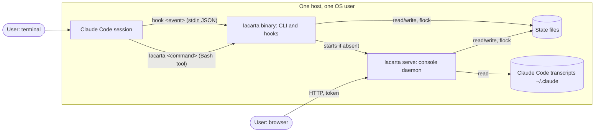
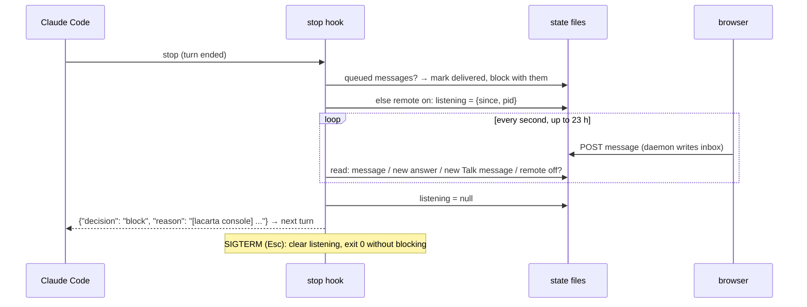

# lacarta: architecture and software design

Companion to [functional.md](functional.md). Describes `lacarta-go/` as built (phases 1 and 2) and the shape phases 3 to 5 must fit into.

## 1. Context



The CLI, the hooks and the daemon are the same binary. They never talk to each other directly: they share state files under locks.

## 2. Components

| Component | Package | Responsibility |
| --- | --- | --- |
| Entry point | `cmd/lacarta` | `os.Exit(cli.Main(args, stdout, stderr))` |
| CLI | `internal/cli` | Argument parsing (the argparse subset the prototype used), every command, the `Refused:`/exit-code contract, project resolution |
| Core | `internal/core` | State types, store (locking, atomic writes, migration), hub, settings, daemon info, questions and effects, inbox, software gates, derived state and next action, sessions, Python-compatible formatting |
| Hooks | `internal/hooks` | Hook events, transcript reader, `install` for Claude Code |
| Server | `internal/server` | Console daemon: HTTP API, auth, page and vendored files, `Serve`, `EnsureDaemon` |
| Web | `web` | Embedded console. Now: `legacy/` (the prototype's page). Phase 3: `dist/` built from `app/` |
| Skill | `skill` | Embedded files for agents. Now: spec templates. Phase 4: the whole skill |
| Parity suite | `internal/golden` | Replays scenarios against Go or the prototype and compares with recordings |

Core is one package on purpose: questions apply effects to gates, gates create questions, sessions touch the hub and stores. Split packages would import each other.

## 3. Data model

All state is JSON. Field names are shared with the Python prototype (schema version 1). Writers replace files atomically (`<name>.tmp` then rename) under an exclusive `flock` on a `.lock` file in the same folder; readers take a shared lock. Go encodes with two-space indent, ASCII only (`core.MarshalIndent`), like the prototype.

### 3.1 `~/.lacarta/` (`$LACARTA_HOME`)

| File | Lock | Content |
| --- | --- | --- |
| `hub.json` | `~/.lacarta/.lock` | `{"projects": {id: HubProject}, "sessions": {session_id: project_id}}`, both in insertion order (`core.OMap`) |
| `settings.json` | `~/.lacarta/.lock` | `{"models": {kind: {role: alias}}, "remote_control": bool}`; missing values fall back to defaults (`core.SettingsRead`) |
| `daemon.json` (0600) | none | `{url, open_url, pid, started_at}`; `open_url` carries `?key=` when bound beyond loopback; valid only while `pid` is alive |
| `tasks/<id>/state.json` | `tasks/<id>/.lock` | a single-agent task's `State` |
| `hooks.log`, `daemon.log` | none | failures, daemon output |

`HubProject`: `id`, `template` (`single`|`software`), `name` (cache; the state's name wins), `root` (software) or `cwd` (task), `created_at`, `archived`.

### 3.2 `State` (`core.State`)

| Field | Type | Notes |
| --- | --- | --- |
| `version` | int | 1 (prototype and Go so far) |
| `template` | string | `single` or `software`; missing means `software` (prototype files) |
| `project` | `{name, summary, created_at, cwd?, named?}` | `cwd` and `named` for tasks |
| `stage` | string | software: `specification`, `implementation`, `final-review`, `done`, `stopped`; task: `active`, `ended` |
| `specs` | ordered `{kind: Spec}` | software only, in the order functional, architecture, stack, security. **Order matters**: the prototype lists them in file order |
| `plan` | `{status, approved_at, submitted_hash?}` | `draft`, `in-review`, `approved`, `changes-requested`, `changed`; empty object for tasks |
| `phases` | `[Phase]` | `{id, title, goal, scope[], covers[], status, started_at, completed_at}`; status `planned`, `in-progress`, `awaiting-approval`, `done` |
| `reviews` | `[Review]` | `{id R-n, phase, type, verdict, summary, reviewer, agent, report (path relative to root), at, specs_hash?}` |
| `questions` | `[Question]` | see below |
| `decisions` | `[Decision]` | `{id D-n, title, decision, rationale, source (Q-n or null), by, agent?, spec, phase, at}` |
| `findings` | `[Finding]` | `{id F-n, phase, review, severity, title, detail, location, scenario, recommendation, status, resolution, at, resolved_at, found_by}`; status `open`, `fixing`, `redesign`, `fixed`, `accepted`, `wont-fix` |
| `activity` | `[{at, kind, text, agent}]` | last 300 |
| `counters` | `{prefix: n}` | id allocation for Q, D, R, F, M |
| `agents` | `[Agent]` | `{id A-n, name, role, model, task, phase, status, summary, avatar (reserved), started_at, updated_at, finished_at, session?}` |
| `inbox` | `[{id M-n, text, at, delivered_at}]` | console messages; last 200 |
| `remote` | bool or null | null follows the Settings default |
| `listening` | `{since, pid}` or null | a Stop hook waiting for the console |
| `attention` | `{text, at}` or null | a terminal prompt (Notification hook) |
| `moved_to` | string? | a task that became a software project |

`phase` fields hold a number or `"spec"`/`"final"` (`core.PhaseRef`).

`Question`: `{id Q-n, kind (question|decision|validation), title, body (markdown), options[], option_help{label: meaning}, allow_free, context{stage, spec?, phase?, finding?}, effect?, status (open|answered|superseded), asked_at, answer{choice, comment, by, at}?, asked_by (agent id), thread[{by (user|agent id), text, at}]}`.

`effect.type`: `spec-approval{spec}`, `plan-approval`, `phase-approval{phase}`, `final-approval`, `finding-triage{finding}`, and the obsolete `models-confirm` (withdrawn on load). Two open questions never share an effect: asking again returns the open one.

`Session` (on A-1): `{cli, id, transcript, cwd, started_at, ended_at}`.

### 3.3 Hashes (compatibility-critical)

- Spec file hash: sha256 of the file bytes, hex.
- Plan hash: sha256 of `json.dumps([[title, goal, scope, covers], ...])` with Python's defaults: `", "` and `": "` separators, every non-ASCII rune escaped as `\uXXXX` (surrogate pairs above the BMP). Implemented by `core.pyDumpsCompact`.
- Specs hash: sha256 of the concatenation of the four spec hashes (canonical order) and the plan hash, as hex strings.

## 4. Interfaces

### 4.1 CLI

Contract for agents (byte-identical to the prototype, enforced by the golden suite):
- Gate refusals: stderr `Refused: <reason>`, exit 2. Usage errors: exit 2 (wording differs from argparse; not a contract). `wait` timeout: exit 3.
- `ask` prints only the id; approvals print `Q-n asks the user to approve ... \`wait Q-n\`.`; `status` and `wait` end with `Next: <sentence>`.
- Project resolution order: `--root`, `--project`, nearest `.lacarta/` (registering it if new), `$LACARTA_PROJECT`. `init`, `install`, `serve`, `hook` need no project; `models` works without one (shows the software kind).
- Actor: `--agent`, else `$LACARTA_AGENT`, else A-1; done or failed agents can't act.

### 4.2 Hook protocol (Claude Code)

`lacarta hook <event>`, payload JSON on stdin; fields used: `session_id`, `cwd`, `transcript_path`, `source`, `prompt`, `message`, `reason`. Output on stdout, one line of Python-style JSON (`core.PyDumps`), or nothing:
- context: `{"hookSpecificOutput": {"hookEventName": "<Event>", "additionalContext": "<text>"}}`
- block (Stop only): `{"decision": "block", "reason": "<text>"}`: Claude Code feeds the reason to the agent as its next input.

| Claude Code event | Hook | Timeout (install) | Matcher |
| --- | --- | --- | --- |
| SessionStart | `session-start` | 30 s | |
| UserPromptSubmit | `prompt` | 15 s | |
| PostToolUse | `post-tool` | 15 s | `*` |
| Notification | `notification` | 15 s | |
| Stop | `stop` | 86400 s | |
| SessionEnd | `session-end` | 15 s | |

Behaviour per event: functional FR-2 to FR-4, FR-18. Every hook exits 0; panics and errors are logged.

Transcript entries (one JSON object per line): `type` `user` or `assistant` with `message.content` a string or a list of blocks (`text`, `tool_use{name, input}`, `tool_result`, `thinking`); flags `isSidechain`, `isMeta`; `timestamp`. Other types seen and ignored: `attachment` (hook output), `system` (`stop_hook_summary`), `api-request-blob`. Stop-hook reasons appear only in those ignored entries, so console messages are never duplicated.

### 4.3 HTTP API (`lacarta serve`)

Base: `http://127.0.0.1:4747/` by default. All JSON responses `application/json; charset=utf-8`, errors `{"error": "<text>"}`.

| Method, path | Request | Response |
| --- | --- | --- |
| GET `/` (`?key=` when exposed) | | the console page; the literal `__LACARTA_TOKEN__` replaced by the token |
| GET `/vendor/{marked,purify,mermaid}.min.js` | | JavaScript, cached a day, no key needed |
| GET `/api/hub` | | `{projects: [Summary], settings: Settings, catalog: Catalog}` |
| GET `/api/p/{id}/state` | | `{id, state: State, derived: Derived, specs?: {kind: markdown}, reports?: {R-n: markdown}, chat: [ChatItem]}` (`specs`/`reports` for software projects, even when empty) |
| POST `/api/p/{id}/answer` | `{id, choice, comment}` | `{ok, result: Question}` |
| POST `/api/p/{id}/discuss` | `{id, message}` | `{ok, result: Question}` |
| POST `/api/p/{id}/message` | `{message}` | `{ok, result: InboxMsg}` |
| POST `/api/p/{id}/remote` | `{on: bool \| null}` | `{ok, result: {remote}}` |
| POST `/api/p/{id}/archive` | `{archived: bool}` | `{ok}` |
| POST `/api/settings` | `{models?: {kind: {role: alias}}, remote_control?: bool}` | `{ok, settings}` |
| GET `/api/events` | | **phase 3**: SSE, events `hub` and `project` (data: id) on change |

Status codes: 200; 400 malformed; 405 other methods; 403 host, origin, token or key; 404 unknown path, project or action; 409 a gate refused (the gate's words); 413 body over 64 KB; 415 not JSON; 500 unreadable state. Text fields are capped (comment and messages at 20,000 characters).

`Summary`: `{id, template, name, where, archived, error?, stage, status (A-1's agent status), agent{id, name, avatar}, session (connected), questions[{id, title, asked_by (name), triage, replies}], attention, listening, listening_since, blocked, updated_at (last activity), moved_to}`.

`Derived`: `{next, open_questions, agent_status{id: status}, listening, remote, pending_messages, blocked}` plus, for software, `{spec_review (none|failed|stale|passed), open_findings{severity: n}, specs_approved, phases_done}`.

`ChatItem`: `{role (user|agent|tool), name? (tool), text, at}`.

`Catalog`: `{models: {alias: {name, id}}, planned: [label], kinds: {id: {label, about, roles: {role: {label, stage, about, default}}}}}`.

## 5. Key flows

### 5.1 Session registration

```mermaid
sequenceDiagram
  participant CC as Claude Code
  participant H as lacarta hook
  participant D as daemon
  participant F as state files
  CC->>H: session-start {session_id, cwd, transcript_path}
  H->>D: EnsureDaemon (daemon.json pid alive? else spawn `serve`, wait up to 5 s)
  H->>F: hub: session known? else nearest .lacarta/ → register software; else create task
  H->>F: A-1.session = {...}; log "connected"
  H-->>CC: additionalContext (URL, kind, id, --project fallback, skill hint, open questions)
  H->>F: CLAUDE_ENV_FILE += LACARTA_PROJECT, LACARTA_SESSION
```

### 5.2 Remote control



### 5.3 Blocking finding

Reviewer `finding add --severity high` → finding open + triage question (effect `finding-triage`) → every gate refuses with `Blocked. ...` and `Next:` says wait → user answers in the console → effect sets the finding's status (or stops the project) → the agent fixes, a new review passes, `finding resolve --status fixed` → gates open.

## 6. Cross-cutting concerns

- **Concurrency**: every write is read-modify-write under the folder's exclusive lock; `Store.Edit` runs `Refresh` (stage transitions, invalidations) before writing, so every writer applies the same rules.
- **Compatibility**: unknown JSON fields are dropped by Go's structs. Add a field to the struct before anything writes it. The prototype ignores fields it doesn't know.
- **Errors**: gate errors (`core.GateError`) are user-facing and worded for agents; other errors are bugs or I/O and print as `lacarta: <error>` with exit 1. Hooks never surface errors to Claude Code.
- **Time**: UTC, seconds, `YYYY-MM-DDTHH:MM:SSZ` (`core.Now`, replaceable via `core.Clock` in tests).
- **Logging**: per-project activity log (user-visible); `hooks.log` and `daemon.log` for failures.
- **Security**: see [security.md](security.md).

## 7. Design decisions

### AD-1: One binary, files as the source of truth
- Context: the CLI and hooks must work while the daemon is down, and a software project's state must be committable.
- Decision: the CLI, hooks and daemon share JSON files under `flock`; the daemon is a reader that also applies user actions through `core`.
- Alternatives considered: the daemon as the only writer (the CLI would need it running; hooks would add network failure modes).
- Consequences: no push between processes; the daemon must watch files for live updates (phase 3, AD-5).

### AD-2: Parity with the prototype by recording, not by reading
- Context: the Python prototype was the reference; reviewing a port line by line misses details.
- Decision: scripted scenarios replayed against both implementations, outputs normalised and compared; `%` lines alternate implementations on the same files; the API compared by running both daemons on one home.
- Consequences: the recordings are the spec for behaviour. After the prototype is removed they stay frozen; intended changes re-record with Go and are reviewed as diffs.

### AD-3: Python-compatible formatting where it is observable
- Decision: `MarshalIndent` (ASCII, no HTML escaping), `PyDumps` for hook JSON and hashes, Python `repr()` for lists in refusals (`['A', 'B']`, `[3, 5]`), `str.capitalize`, ordered maps for `specs` and the hub.
- Consequences: a little odd-looking Go, in exchange for byte-identical output and hash compatibility with existing projects.

### AD-4: Remote control through a long Stop hook
- Context: Claude Code has no API to inject a message into an idle interactive session.
- Decision: a Stop hook with nothing to deliver waits (up to 23 h; installed with a 24 h timeout) and answers with a block reason, which Claude Code treats as the agent's next input.
- Alternatives considered: read-only mirror; delivering only at the next prompt.
- Consequences: the terminal is held while listening (Esc takes it back); Claude Code labels the message "Stop hook blocking error" (cosmetic).

### AD-5: Live updates by server-sent events from file polling (phase 3, proposed)
- Decision: the daemon checks the modification times of `hub.json` and each project's `state.json` every 500 ms and emits `hub` / `project` events; the page re-fetches. Standard library only.
- Alternatives considered: fsnotify (a dependency, platform quirks), WebSockets (bidirectional is not needed).

### AD-6: Kinds of project behind an interface (phase 5)
- Decision: extract `Kind{ID, Label, Roles, Commands, Refresh, NextAction, Derived}` when the second real kind (security audit) exists; until then functions branch on `template`, mirroring the prototype so parity could be checked line by line.

## 8. Repository layout

```
lacarta-go/
├── cmd/lacarta/           main
├── internal/core/         state, store, hub, settings, questions, gates, sessions, formatting
├── internal/cli/          parser and commands
├── internal/hooks/        hook events, transcript reader, install (+ tests)
├── internal/server/       daemon, API, auth (+ tests, including API parity)
├── internal/golden/       parity suite
├── skill/                 embedded skill files (templates now)
├── web/                   embedded console (legacy/ now; app/ and dist/ in phase 3)
├── testdata/scenarios/    parity scenarios
├── testdata/golden/       recordings (the behavioural spec)
└── docs/specs/            these specs
```
