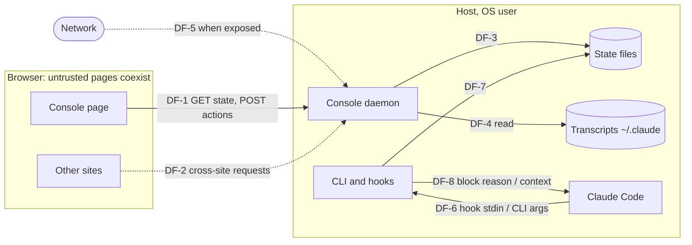

# lacarta: security specification and threat model

Scope: the `lacarta` binary (CLI, hooks, console daemon) on one host, used by one OS user. Requirements marked **done** are implemented and tested; **to do** ones belong to later phases.

## 1. Assets

| ID | Asset | Confidentiality | Integrity | Availability |
| --- | --- | --- | --- | --- |
| A-1 | The ability to steer agent sessions (console messages become the agent's input; the agent can run commands with the user's rights) | high | high | medium |
| A-2 | Decisions and approvals (an approval lets the framework move on; accepting a risk closes a blocking finding) | medium | high | medium |
| A-3 | Session transcripts in `~/.claude` (code, secrets the agent saw, conversations) | high | low | low |
| A-4 | Project state and specs (`.lacarta/`, `~/.lacarta/`) | medium | high | medium |
| A-5 | The console token and key | high | high | low |

## 2. Actors and trust levels

| Actor | Trust | Can reach |
| --- | --- | --- |
| The user, at the browser or terminal | full | everything |
| Agents (Claude Code and subagents) | trusted to act for the user, not to approve for them | CLI, state files (same OS user) |
| Other web pages in the user's browser | none | the console's port through the browser (CSRF, DNS rebinding) |
| Other machines on the network | none | the console's port when bound beyond loopback |
| Other OS users on the host | none | loopback ports; files only if permissions allow |

## 3. Trust boundaries and data flows

- DF-1: the console page to the daemon (token in a header; same origin).
- DF-2: other sites trying to reach the daemon through the user's browser.
- DF-3, DF-7: state file writes by the daemon and by the CLI/hooks.
- DF-4: transcript reads, paths taken from state files.
- DF-5: network clients when bound to a non-loopback address.
- DF-6: hook payloads and CLI arguments from Claude Code.
- DF-8: lacarta's output that becomes agent input (context, console messages).

## 4. Threats (STRIDE)

| ID | Component / flow | STRIDE | Threat | Likelihood | Impact | Severity | Mitigation (SR) |
| --- | --- | --- | --- | --- | --- | --- | --- |
| T-1 | DF-2 | Spoofing / Tampering | A malicious site POSTs to `127.0.0.1:4747` to send a message to an agent (= run commands) or approve a gate | medium | high | high | SR-1, SR-2 |
| T-2 | DF-2 | Spoofing | DNS rebinding: a site's hostname resolves to 127.0.0.1 and reads state or posts actions | low | high | high | SR-3 |
| T-3 | DF-5 | Spoofing / Info disclosure | A network client reads projects or acts when the console is bound beyond loopback | medium | high | high | SR-4 |
| T-4 | DF-4 | Info disclosure | A crafted `transcript` path in a state file makes the console serve any file | low | high | medium | SR-5 |
| T-5 | DF-1 | Tampering (XSS) | Markdown from agents (question bodies, specs, reports, chat) injects script into the console, which holds the token | medium | high | high | SR-6, SR-7 |
| T-6 | DF-1 | Info disclosure | The console is framed or its responses cached or sniffed | low | medium | low | SR-7 |
| T-7 | DF-1 | Denial of service | Oversized bodies exhaust memory | low | low | low | SR-8 |
| T-8 | DF-6 | Tampering | Malformed hook input crashes the hook and breaks the user's session | medium | medium | medium | SR-9 |
| T-9 | Agents | Elevation of privilege | An agent approves its own gate or accepts a high finding | medium | high | high | SR-10 |
| T-10 | DF-3, DF-7 | Tampering | Concurrent writers corrupt or lose state | medium | medium | medium | SR-11 |
| T-11 | DF-8 | Repudiation | Console messages or answers can't be told apart from agent actions | low | medium | low | SR-12 |
| T-12 | A-5 | Info disclosure | The console key, when exposed, lands in transcripts and logs | medium | medium | medium | Accepted risk AR-2 |
| T-13 | DF-5 | Info disclosure / Tampering | Plain HTTP on a network: the key and traffic can be sniffed | medium | high | high | Accepted risk AR-1 (docs: tunnel instead) |
| T-14 | Host | Elevation of privilege | Another OS user on the host reaches the loopback console | low | high | medium | SR-1 (token for actions); AR-3 for reads |
| T-15 | Supply chain | Tampering | A compromised dependency in the binary or console | low | high | medium | SR-13 |

## 5. Security requirements

| ID | Requirement | Mitigates | Verified by |
| --- | --- | --- | --- |
| SR-1 | Every POST needs the per-run token (random, 18 bytes) in `X-Lacarta-Token`, compared in constant time. The token is only delivered inside the page. **Done** | T-1, T-14 | `server_test.go: TestAuth` |
| SR-2 | Every POST must carry `Origin: http://<Host>` and `Content-Type: application/json`. **Done** | T-1 | `TestAuth` |
| SR-3 | The `Host` header must be a name the daemon was started for (loopback names, the bound address, `--allow-host`); a wildcard bind without `--allow-host` relies on the key. **Done** | T-2 | `TestAuth` (host check) |
| SR-4 | Bound beyond loopback, every request except the vendored scripts needs the key (`?key=` on the page, the header afterwards); the URL with the key is printed once and stored in `daemon.json` with mode 0600. **Done** | T-3 | `TestAuth` (keyed) |
| SR-5 | Transcripts are served only if the resolved path (symlinks followed) is a regular `.jsonl` file inside `~/.claude` or `$CLAUDE_CONFIG_DIR`. Review reports only from inside the project's `.lacarta/`. Vendored files only from the embedded set, no `..`. **Done** | T-4 | `hooks_test.go: TestTranscriptOutsideClaudeIsRefused`; `TestAuth` (traversal) |
| SR-6 | The console renders markdown only through DOMPurify; Mermaid output is sanitised again; text is escaped everywhere else. **Done in the legacy page; must hold in Svelte** (no `{@html}` without DOMPurify) | T-5 | review; phase 3 checklist |
| SR-7 | Responses carry a strict CSP (`default-src 'none'`, scripts and styles from self, fonts from Google Fonts only, `connect-src 'self'`, `frame-ancestors 'none'`), `X-Frame-Options: DENY`, `nosniff`, `no-referrer`, `no-store` (vendored files: private, one day). **Done**. Phase 3: drop `'unsafe-inline'` for scripts once the Svelte build emits no inline script (inject the token as a `<meta>` tag or a JSON block read at start) | T-5, T-6 | `TestPageHasToken`; review |
| SR-8 | Request bodies are limited to 64 KB; text fields are capped (20,000 characters for comments and messages). **Done** | T-7 | `TestAuth` (413) |
| SR-9 | Hooks never exit non-zero or crash the session: malformed input, I/O errors and panics are logged to `~/.lacarta/hooks.log`. **Done** | T-8 | golden `hooks` (malformed stdin) |
| SR-10 | Approvals and triage are only recorded from the console or by `answer` (terminal, the user's words); agents can't resolve a high or critical finding other than `fixed`, and only after the triage answer; accepting a risk needs a written reason. **Done** | T-9 | golden `software_flow` |
| SR-11 | Every write is read-modify-write under an exclusive `flock`, then an atomic rename. **Done** | T-10 | review |
| SR-12 | Every answer and decision records who gave it (`user`, `user (terminal)`, agent id); console messages are tagged `[lacarta console]` and logged. **Done** | T-11 | golden suite |
| SR-13 | No third-party Go dependencies; console dependencies pinned with a lockfile; vendored libraries at known versions. **Done for Go; to do for the console** | T-15 | `go.mod`; review |

Cover at least:

- Authentication and session handling: per-run token (SR-1), key when exposed (SR-4); no user accounts (single user by design).
- Authorisation: the browser user can do everything; agents can't approve or accept risks (SR-10).
- Input validation and output encoding: JSON bodies typed and capped (SR-8); markdown sanitised (SR-6); hook input tolerated when malformed (SR-9).
- Secrets management: the token lives in memory and in the page; `daemon.json` is 0600; nothing secret in the repo.
- Cryptography: `crypto/rand` for the token; sha256 only for change detection, not security. No TLS (AR-1).
- Logging and audit: activity log per project; decisions with their author; hooks and daemon logs hold errors, never tokens. Note AR-2 for the session context.
- Dependency and supply chain: SR-13.
- Error handling: API errors are short messages; Go errors don't include stack traces (panics in hooks go to `hooks.log` only).

## 6. Accepted risks

| ID | Risk | Why accepted | Decision |
| --- | --- | --- | --- |
| AR-1 | Plain HTTP when the console is bound beyond loopback (T-13) | Loopback is the default; the docs recommend an SSH tunnel; TLS would need certificates | Prototype design, kept in the port |
| AR-2 | When exposed, the session context gives agents the console URL **with its key**, and Claude Code stores it in transcripts (T-12) | Single-user machine; the transcripts are as sensitive as the console | **Open: the user decides** (option: context without the key) |
| AR-3 | Reads are open on loopback without the token: another OS user on the host can read project state through `127.0.0.1` (T-14) | Single-user hosts are the target; actions still need the token | Prototype design; revisit for shared hosts (require the token on every request) |
| AR-4 | The console can steer agents that run commands with the user's rights (A-1) | That is the feature; it is guarded by SR-1 to SR-4 | User's choice (remote control on by default) |

## 7. Severity scale

The reviews use this scale. High and critical stop development until the user decides.

- **Critical**: exploitable remotely with no or trivial preconditions, leading to full compromise, code execution, broad data exposure or leaked production secrets.
- **High**: serious impact with a realistic precondition (an authenticated user, a specific configuration): authorisation bypass, injection, account takeover, sensitive data exposure.
- **Medium**: limited impact, or hard to exploit: a missing hardening measure the spec requires, information leaks that aid an attack, denial of service by a privileged user.
- **Low**: defence in depth or best-practice gaps with no direct exploit path.
- **Info**: observations, no risk on their own.
